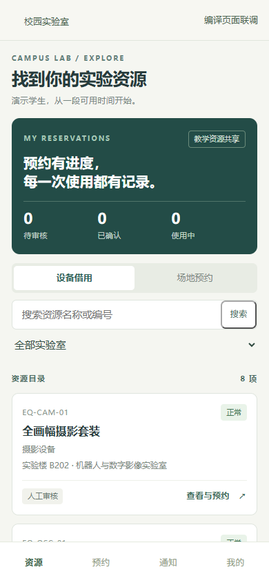
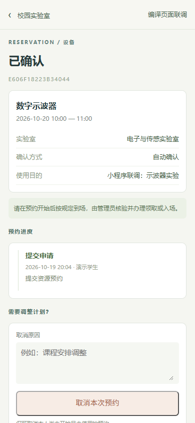
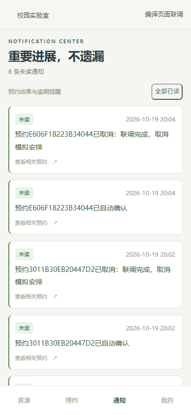

# 校园实验室设备预约与借用管理系统

[在线演示](https://campus-lab-equipment-manager.onrender.com/) · [公开源码](https://github.com/yvming67-gif/campus-lab-equipment-manager) · [系统分析报告（Word）](docs/分析报告/校园实验室设备预约与借用管理系统分析报告-宋明俞-1602240221-终稿.docx) · [持续检查](https://github.com/yvming67-gif/campus-lab-equipment-manager/actions)

面向课程展示的演示项目，支持设备借用与整间实验室场地预约，可本地运行或配置云端演示。原生微信小程序用户端支持查询、预约、取消、进度和通知，管理业务使用网页。业务、身份、消息和资源数据均为模拟示例；演示验证不代表真实学校上线效果。

## 云端演示

[免费部署到Render](https://render.com/deploy?repo=https://github.com/yvming67-gif/campus-lab-equipment-manager) · [Render与Neon部署说明](docs/云端部署.md)

蓝图使用Render免费网页计算、Neon PostgreSQL 17与私有附件存储。先按说明创建Neon项目，再将连接信息直接填入Render控制台。服务密钥自动生成，不将凭据提交仓库。当前公开演示地址为 https://campus-lab-equipment-manager.onrender.com/ ，实际验证范围见[云端验收报告](docs/云端实际验收报告.md)。

免费服务会休眠，首次唤醒需要等待；休眠时后台任务暂停、恢复后补扫。已有[云端联合归档与恢复工具](docs/云端备份与恢复.md)，真实Neon数据库和私有桶的联合恢复仍待单独演练，不能引用本地恢复证据替代。公开演示账号只用于共享模拟数据，详细边界见部署说明。

当前采用仅使用免费额度、耗尽后接受暂停或操作受限的策略，不自动升级付费。额度与账单核实边界见[免费额度与停用策略](docs/云端免费额度与停用策略.md)，验收证据的只读复核见[云端独立复核](docs/云端实际独立复核报告.md)。

## 在Windows电脑上运行

1. 安装**Python 3.13，Windows 64位**，安装时勾选“Add python.exe to PATH”。[Python官方下载](https://www.python.org/downloads/windows/)。
2. 在本仓库页面点击绿色“Code”→“Download ZIP”，**先解压**到本地文件夹；不要直接在压缩包内启动。
3. 打开解压后的项目文件夹，双击 **启动演示.cmd**。首次运行需要网络，会创建独立虚拟环境、下载约364MB的官方PostgreSQL 17.11、初始化私有数据库并写入模拟数据。按窗口显示等待6个步骤完成。
4. 浏览器会自动打开登录页。默认地址是 http://127.0.0.1:8000 ，若端口被其他程序使用，会自动选择空闲端口，**以启动窗口显示的地址为准**。演示账号见下表，密码均为`Demo@2026`。
5. 演示时保留启动窗口；按Ctrl+C停止网页与后台。需要停止数据库时双击“停止数据库.cmd”。再次启动会保留预约、权限与其他业务记录。

无需安装Git、Node.js或另行安装PostgreSQL，也无需GitHub登录。数据和依赖仅在项目的`.local`、`.venv`中，公开源码不包含原电脑的数据库、路径配置或密钥。首次下载需保持联网，初始化完成后常规本地演示可离线运行。

[运行指南与常见问题](docs/运行指南.md)包含安装前提、中文路径、运行库缺失、端口占用和复验步骤。自动安装适用于Windows x64；其他平台见下文。新电脑验收的实际结果与限制见[测试与验收记录](docs/测试与验收记录.md)。

命令行等效入口及安装验证：

```powershell
python tools/start_local.py --setup
python tools/start_local.py --setup --no-browser --smoke-test
```

启动器同时运行网页服务及每30秒扫描的任务进程；后台运行时每23小时触发完整备份，失败一小时后重试。中文目录使用Windows短路径或经过目标校验的可写英文目录联接，实际数据仍保存在项目内。不要在运行中移动项目或删除目录别名。

## 微信小程序用户端

1. 先启动上面的Django后端，记录“启动成功”显示的本机地址。
2. 打开微信开发者工具，导入仓库中的`miniprogram`目录，选择工具提供的测试号或自己的AppID；当前配置保留演示占位AppID。
3. 开发者工具本地调试关闭合法域名校验，编译后以学生或教师账号登录；在小程序登录页填写后端实际地址。默认密码仍为`Demo@2026`。

[导入与运行指南](miniprogram/README.md) · [需求、接口与验收](docs/微信小程序扩展说明.md)

小程序与网页读取同一套PostgreSQL记录，普通设备自动确认，受限设备和场地等待网页管理员审批。当前交付用于本地开发者工具演示；原生微信容器、真机与正式发布的验证范围见文档。网页本身仍可独立运行，小程序不增加网页首次安装所需的组件。

原生页面编译后的界面预览（浏览器渲染联调，非微信容器截图）：

  

## 演示账号

通过“进入统一身份入口”进入**独立模拟学校身份提供方**。以下账号共用公开的课程演示密码 `Demo@2026`，不是任何真实账号的密码。业务用户表只保存不可用密码标记。

|账号|角色|可演示内容|
|---|---|---|
|student / student2|学生|设备申请、本人进度、取消、异常说明|
|teacher|教师|设备与整间场地申请、本人记录|
|admin|实验室管理员|两间示例实验室审批、交接、异常、工单、验收|
|tech|维修人员|被指派任务、过程与结果|
|sysadmin|系统管理员|角色、管理范围、资质、开放日历及参数|
|director|实验教学中心主任|中心统计与只读审计|

## 已实现的业务规则

- 设备与场地独立预约，场地不自动占用室内设备；仅教师预约场地。
- 普通设备规则检查后自动确认；高价值、危险、需资质设备和所有场地人工审核。
- 待审核不占资源时段，批准前在事务中复核；同一资源的有效重叠时段最多一份成功。
- 初始14天窗口、30分钟粒度、最长8小时、08:00至20:00、不跨日；每类未来申请3项，同时最多3台或套设备。
- 身份、培训资格、实验室范围、逾期、配额及现场前次未完成使用逐项检查。
- 设备标签、配件与交接时间保留快照；场地有独立实际开始/结束记录。
- 普通无关联报告先核实，安全事件按规则阻断；维修执行人（含改派前实际执行者）不得自验收，恢复需核查全部阻断。
- 审计只追加；站内通知和业务同事务保存，模拟外部发送独立重试。

## 技术与数据

Python 3.13、Django 5.2.18、psycopg 3.3.6、PostgreSQL 17.11；Django模板和响应式CSS，无额外前端构建步骤。状态规则集中在 `core/services.py`，权限同时检查角色与对象范围，区间互斥由PostgreSQL条件排斥约束兜底。

`models/`包含36个实体、289个字段、61条物理外键的JSON、DBML、Mermaid、可编辑draw.io/SVG，以及公开的矢量ERD总图与A4分域图册。`docs/specification.json` 是统一需求基线，包含27项FR/UC、46条业务规则、运行恢复约束DC-01（历史BR-47）、11项质量需求和66条验收场景。系统分析报告以可编辑Word随仓库提供，包含项目愿景、业务建模、系统需求、用例规约与需求追踪。

## 业务分析与验证范围

当前分析基线2.3区分题设、课程约定、业务假设、公开资料和实现证据；设备、场地、异常维修及利用信息分别建立现状与改进实现，所有系统用例都有结构化规约。根据教学材料补充了需求获取方法比较、涉众利益取舍、步骤数据与规则契约，以及分析类、内部协作和状态模型；[课程规范完善与验证范围](docs/课程规范完善/README.md)说明具体采用方法。

[业务分析材料与完整追踪](docs/逻辑整改/README.md)记录来源、职责迁移、状态和证据覆盖边界。2.2批次完整后端162项通过，修复了维修改派后原执行人仍可自验收，以及原开始后复核误计未来配额的问题；原始失败与回归证据保留。历史154项及既有24项客户端、11项启动和8项独立场景记录保留批次与环境，不能把不同运行合并为同一次验收。

支持风险变化后追加复核、前序延误到场协调、固定设备场地依赖、单日闭馆例外、维修改派及损坏异议；默认日间教学短借。真实学校身份、消息提供方及微信容器/真机仍待外部验收；共享演示HTTPS已完成的范围见[云端实际验收报告](docs/云端实际验收报告.md)，不据此宣称校园生产上线。

2026年10月23日剩余整改：后端192项通过（含非文件存储联合归档恢复3项），客户端30项通过，7页原生模板编译通过；本地模拟证据和外部待验范围见[本次整改记录](docs/整改/剩余整改-2026-10-23.md)，三类CI与9项公开站点增量检查见[发布核验](docs/整改/发布核验-2026-10-23.md)。

## 数据模型图

[完整ERD总图](models/ERD/完整ERD总图.pdf) · [A4分域图册](models/ERD/分域ERD图册.pdf) · [可编辑draw.io源图](models/图形源文件/ERD-00-完整实体关系总图.drawio) · [读图与编辑说明](models/README.md)


完整字段按身份权限、资源开放、预约规则、现场使用、异常维修、审计通知分为六个域。下载仓库后可打开`models/ERD/交互图谱.html`离线搜索和缩放；图中R01-R61与关系索引逐条对应。

## 常用操作与验证

以下命令使用已安装依赖的Python。本机启动器记录的解释器可在 `.local/runtime.json` 查看；新安装默认 `.venv/Scripts/python.exe`。

```powershell
python manage.py check
python manage.py migrate
python manage.py seed_demo
python manage.py prepare_demo
python manage.py test core.tests core.miniapi_tests core.remediation_tests core.operations_tests core.independent_tests core.logic_alignment_tests core.report_tests core.followup_tests core.backup_tests --noinput
python manage.py test core.benchmark_tests --noinput
python tools/export_model.py
python tools/validate_registry.py
python tools/validate_analysis_models.py
python tools/backup_restore.py --restore-test
```

`seed_demo` 只补齐模拟主数据，不清空已有业务。`prepare_demo` 在当前08:00至20:00开放时段准备模拟已获准的设备/场地记录，便于立即演示现场交接；它不修改电脑时间，也不代表真实历史申请。场地和设备开始使用仍受30分钟宽限检查。

负载测试使用**独立测试库**，包含1万台新增模拟设备、10万条历史记录、50个会话、每秒10请求；测试结束删除测试库，不污染演示库。备份恢复工具只恢复到独立演练库，排除有效会话并核对证据摘要，不覆盖开发库。

## 已有PostgreSQL或非Windows环境

安装 `requirements.txt`，配置 PGHOST、PGPORT、PGDATABASE、PGUSER、PGPASSWORD 后执行迁移和种子命令。已初始化私有数据库的目录默认优先使用`.local/database.json`，不会受电脑上其他项目的PG变量干扰；需要明确切换到外部实例时，设置`CAMPUS_USE_EXTERNAL_DATABASE=1`。初始化用户应能创建测试数据库及 `btree_gist` 扩展；课程用本地实例由启动器初始化。网页运行 `python manage.py runserver 127.0.0.1:8000`，另开终端运行 `python manage.py run_jobs --loop`。不要用SQLite替代并发约束测试。

## 文档导航

- [需求来源、全部用例规约与三类追踪矩阵](docs/逻辑整改/README.md)

- [整改概览与证据](docs/整改/整改概览.md)
- [独立复验报告](docs/整改/独立复验报告.md)
- [版本与迁移说明](docs/整改/版本与迁移说明.md)
- [运行与恢复指南](docs/整改/运行与恢复指南.md)
- [ERD与数据设计说明（PDF）](docs/ERD与数据设计说明.pdf)
- [微信小程序运行指南](miniprogram/README.md)
- [微信小程序扩展说明](docs/微信小程序扩展说明.md)
- [演示操作说明](docs/演示操作说明.md)
- [需求、实现与验证映射](docs/需求与实现映射.md)
- [测试与验收记录](docs/测试与验收记录.md)
- [独立验收报告](docs/独立验收报告.md)
- [运行指南](docs/运行指南.md)
- [系统分析报告（Word）](docs/分析报告/校园实验室设备预约与借用管理系统分析报告-宋明俞-1602240221-终稿.docx)
- [模型源文件说明](models/README.md)

代码采用MIT许可证。演示系统绑定本机回环地址；正式校园接口、备份保留策略及真实业务制度仍需由目标学校确认。
