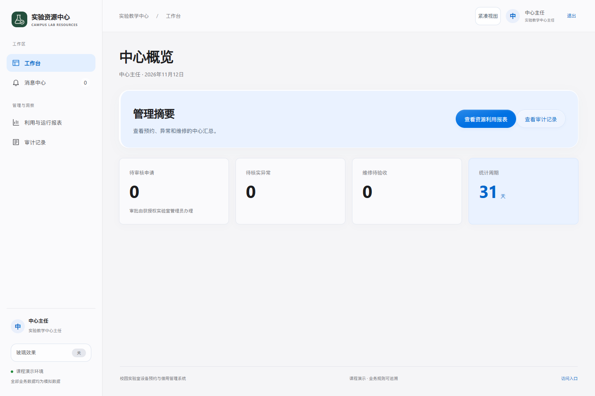
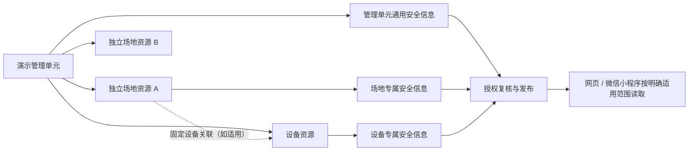

<div align="center">
  
  <h1>校园实验室设备预约与借用管理系统</h1>
  <p>设备借用 · 场地预约 · 现场交接 · 异常与维修追踪</p>
  <p><a href="https://campus-lab-equipment-manager.onrender.com/login/">在线演示</a> · <a href="#windows本机运行">本机运行</a> · <a href="#分析报告与数据模型">项目文档</a></p>
</div>

[](https://github.com/yvming67-gif/campus-lab-equipment-manager/actions/workflows/ci.yml)

面向高校实验教学中心的设备借用与场地预约系统。学生和教师可查询资源、提交申请并查看进度。实验室管理员、维修人员及其他岗位在网页处理各自的业务。网页和原生微信小程序共用 Django 后端与 PostgreSQL 数据库。在线环境使用模拟身份、资源和业务数据。

## 快速开始

### 在线网页

1. 打开[校园实验资源中心](https://campus-lab-equipment-manager.onrender.com/login/)，点击「选择演示账号」。
2. 选择 `student` 或 `student2`（学生），或 `teacher`（教师）。这三个公开账号使用密码 **`Demo@2026`**。
3. 登录后从资源目录查找「数字示波器」，选择可用时段并提交预约。普通设备通过检查后自动确认。仅教师可申请整间实验室，申请提交后进入待审核。

公开账号的预约、消息和配额由使用同一账号的人共享。持独立密码的岗位和专用师生账号也从同一网页登录，账号及职责见[角色与能力](#角色与能力)。免费服务休眠后的首次打开可能等待约一分钟。[项目入口与访问说明](docs/项目入口.md) · [按角色操作指南](docs/演示操作说明.md)

## 角色与能力

| 角色 | 网页账号 | 主要操作 |
| --- | --- | --- |
| 学生 | `student`、`student2`、`student_lab` | 查询与预约设备、查看进度、取消预约、报告异常 |
| 教师 | `teacher`、`teacher_lab` | 预约设备及整间实验室、跟进课程资源安排 |
| 实验室管理员 | `admin` | 审核所负责实验室的申请、办理设备借还与场地交接、核实异常、指派维修及验收 |
| 维修人员 | `tech` | 查看本人维修任务、记录处理进展并提交维修结果 |
| 系统管理员 | `sysadmin` | 维护角色授权、基础数据、预约参数及默认开放日历 |
| 实验教学中心主任 | `director` | 查看中心利用率报表和只读审计记录 |

`student_lab`、`teacher_lab` 及四个管理与协作岗位使用各自的密码，由部署方私下提供。小程序提供师生查询与预约。管理操作在网页完成。

<details>
<summary>查看本机网页演示截图</summary>



查看[分组教室目录](docs/演示界面/教室目录.png)和[场地详情](docs/演示界面/场地详情.png)。截图使用本机模拟数据。

</details>

## 分析报告与数据模型

| 材料 | 入口 |
| --- | --- |
| 系统分析报告 | [可编辑 Word 报告](docs/分析报告/校园实验室设备预约与借用管理系统分析报告-宋明俞-1602240221-终稿.docx) |
| 业务与需求基线 | [来源、组织价值、流程、29份用例规约及追踪](docs/逻辑整改/README.md) · [分析模型](docs/课程规范完善/README.md) |
| 数据设计 | [ERD与数据设计说明](docs/ERD与数据设计说明.pdf) |
| 矢量ERD | [完整总图](models/ERD/完整ERD总图.pdf) · [A4分域图册](models/ERD/分域ERD图册.pdf) |
| 可编辑模型 | [draw.io总图](models/图形源文件/ERD-00-完整实体关系总图.drawio) · [JSON、DBML、Mermaid、UML及离线交互图说明](models/README.md) |

[模型目录](models/README.md)列出各数据域及读图方法。[验证记录](docs/验证说明.md)汇总已覆盖的场景及待验证事项。

## 资源结构与安全信息

网页和小程序的资源详情读取对应的场地或设备档案。安全内容通过带来源、版本和复核期限的记录发布，可设为管理单元通用信息或具体资源专属信息。详情仅展示已发布的安全信息。



资源专属信息只适用于指定场地或设备；固定设备不会自动继承所在场地的专属版本。管理单元通用信息是否适用于某项资源，仍以正式批准的适用范围为准。

资源名称、地点、容量与设施均为课程模拟数据；真实实拍图需经过资源对应、授权和隐私核验后才可加入。玻璃效果使用 CSS 和 WXSS 实现。详见[图片来源与授权](docs/图片来源.md)、[案例研究与设计决定](docs/案例研究与设计决定.md)和[资源目录与安全信息](docs/场地目录与安全信息.md)。

## 运行方式

### Windows本机运行

1. 安装[Python 3.13 x64](https://www.python.org/downloads/windows/)，勾选“Add python.exe to PATH”。
2. 点击本仓库 **Code → Download ZIP**，完整解压。
3. 双击 **启动演示.cmd**。首次需联网、约2GB可用磁盘，并下载约364MB的PostgreSQL组件；无需预装Git、Node.js或数据库服务。
4. 使用启动窗口显示的地址，默认 `http://127.0.0.1:8000`；端口占用会自动选择空闲端口。

本机默认的七个模拟账号统一使用密码 **`Demo@2026`**，包括 `admin`、`tech`、`sysadmin` 和 `director`。[本机账号及职责](docs/项目入口.md#windows本机账号)

保留启动窗口；按 `Ctrl+C` 停止网页与后台，双击 **停止数据库.cmd** 停止本项目数据库。再次启动保留数据；私有配置在不提交的 `.local`，依赖在 `.venv`。[运行指南](docs/运行指南.md) · [已有PostgreSQL及开发检查](docs/开发与验证.md)

### 微信小程序

微信公开入口尚未确认可用。原生小程序源码及本机运行方式见[小程序开发指南](miniprogram/README.md)，正式版本状态见[微信发布说明](docs/微信发布说明.md)。

## 业务约定

- 学生和教师可申请设备，仅教师可申请整间场地；可移动设备独立预约，固定设备遵守关联场地限制。
- 普通设备规则检查后自动确认；受限设备与场地人工审批。待审核不占时段，但计入个人未来配额，批准前重新检查。
- 默认未来14天、30分钟粒度、同日最长8小时；按开放日历执行。每类未来预约最多3项，同时最多使用3台或套设备。
- 候选时段只是查询快照。资源、资格、冲突与配额由服务端在提交和批准时重新核验。
- 实际交接与计划分开记录；异常分级核实，维修执行与验收分离，恢复前检查全部限制。
- 状态历史只追加。站内通知与业务同事务保存，外部消息失败不得撤销已保存业务；未知结果重试保留原请求标识。

这些属于课程基线，不能据此推定某所学校已有同样制度。[需求与规约](docs/逻辑整改/README.md) · [接口契约](docs/接口与通道.md)

## 技术与维护

Python 3.13 / Django 5.2 / PostgreSQL 17，网页采用Django模板，小程序采用原生JS/WXML/WXSS。常规网页运行无需前端构建。

```text
core/          领域服务、权限、接口、任务及测试
templates/     网页模板
static/        样式、交互与经许可后方可加入的项目资源照片目录
miniprogram/   师生原生微信端
docs/          正式分析、模型说明、运行与验证文档
models/        ERD及可编辑UML源文件
tools/         启动、校验、备份及恢复工具
```

[验证与验收摘要](docs/验证说明.md) · [开发与验证命令](docs/开发与验证.md) · [云端部署](docs/云端部署.md) · [备份恢复](docs/云端备份与恢复.md) · [免费额度策略](docs/云端免费额度与停用策略.md)

代码采用MIT许可；当前不打包第三方实验室照片。新增图片必须单独核对许可和资源对应关系，见[LICENSE](LICENSE)及[图片来源](docs/图片来源.md)。
