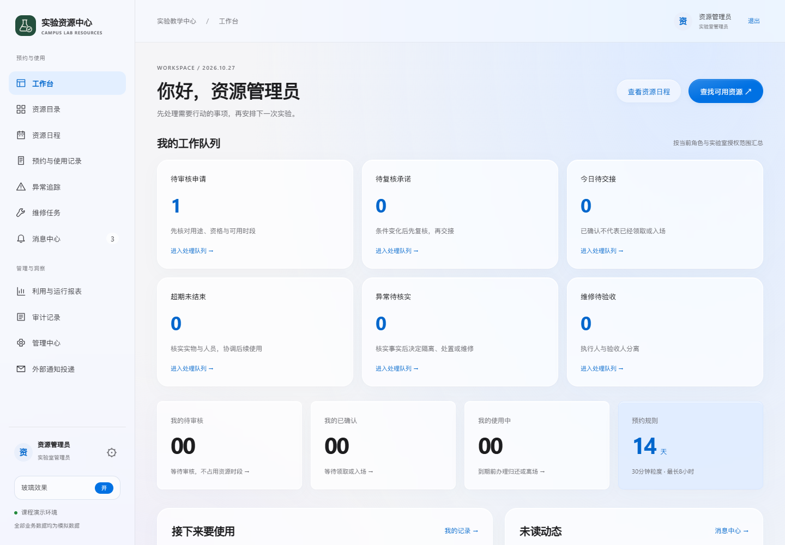
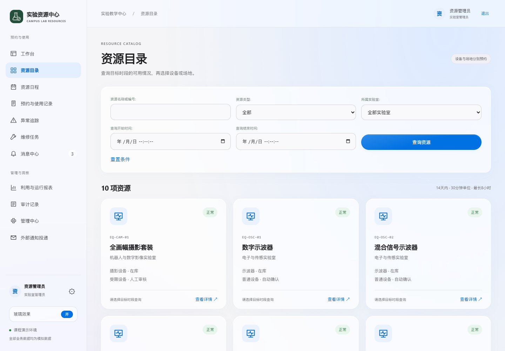
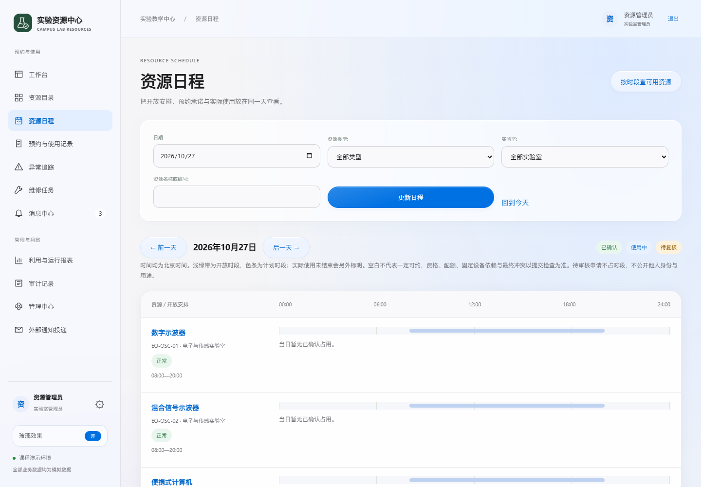
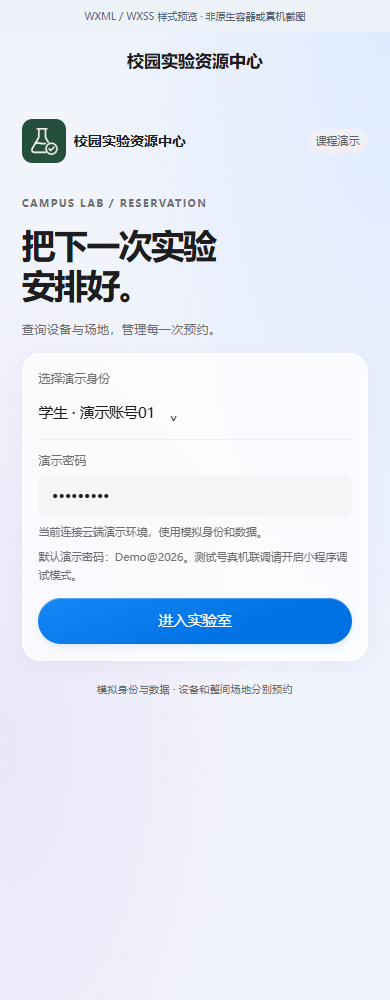
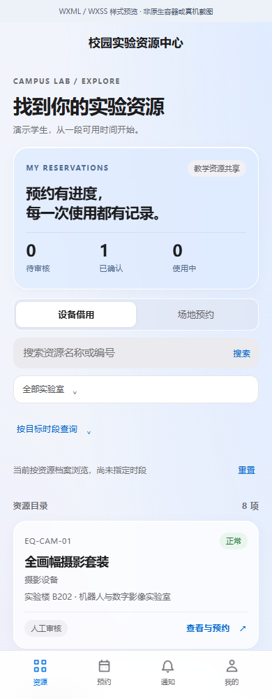
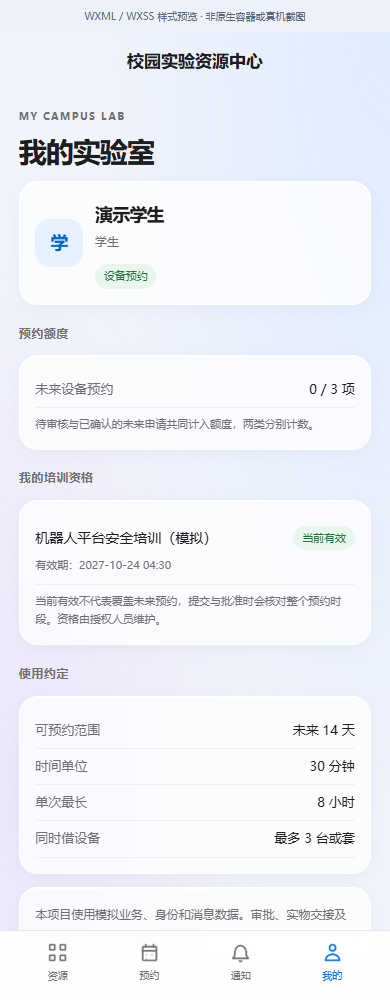
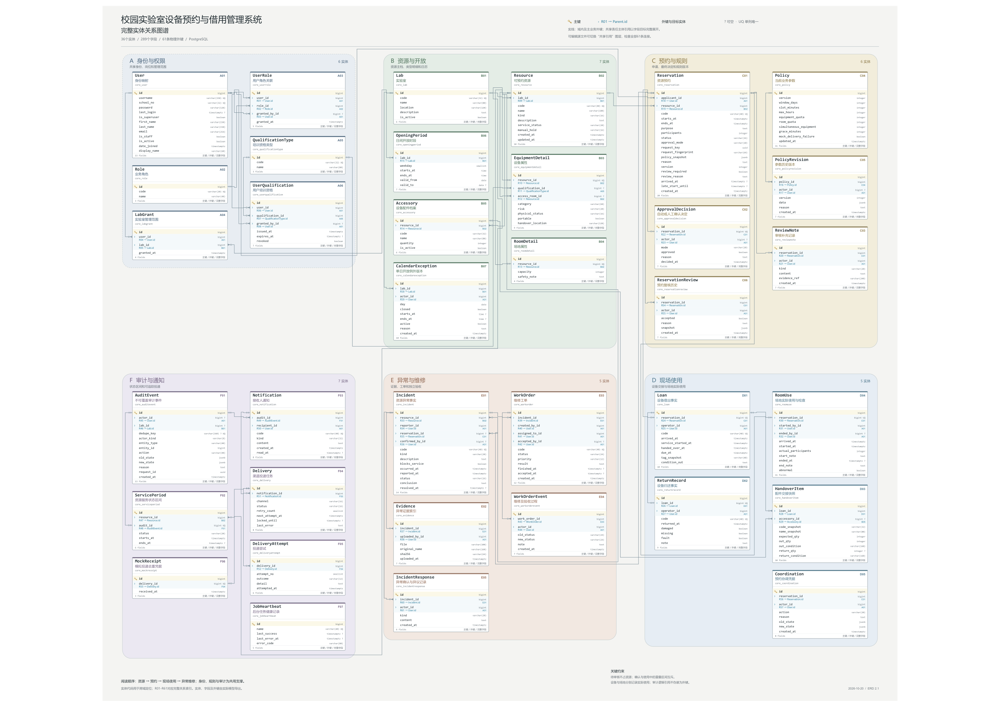

<div align="center">
  
  <h1>校园实验室设备预约与借用管理系统</h1>
  <p>设备借用 · 场地预约 · 现场交接 · 异常与维修追踪</p>
</div>

<p align="center">
  <a href="https://campus-lab-equipment-manager.onrender.com/">在线演示</a> ·
  <a href="#快速开始">快速开始</a><br>
  <a href="docs/分析报告/校园实验室设备预约与借用管理系统分析报告-宋明俞-1602240221-终稿.docx">分析报告</a> ·
  <a href="models/ERD/分域ERD图册.pdf">数据模型</a> ·
  <a href="docs/全面审查/README.md">全面审查</a> ·
  <a href="docs/整改/修复20261025/修复记录.md">修复与复验</a>
</p>

[](https://github.com/yvming67-gif/campus-lab-equipment-manager/actions/workflows/ci.yml)

面向高校实验教学中心的课程演示项目。学生和教师通过网页或原生微信小程序查询资源、申请预约和查看进度；管理员通过网页处理审批、交接、异常和维修。两端使用同一套业务规则和PostgreSQL记录。

> **演示范围**：使用模拟身份、资源和业务数据。免费云端实例闲置后可能需要等待唤醒，休眠期间后台任务暂停。学校真实认证、外部消息、云端联合恢复和微信正式发布尚有外部验证条件；当前发现、已验证范围及待整改问题以[全面审查记录](docs/全面审查/README.md)为准。

## 界面预览

界面采用接近 iOS 的系统字体、圆角、浅色层次与液态玻璃视觉。网页可切换玻璃效果，支持卡片高光、按钮按压和提交反馈；不支持模糊时使用清晰的不透明表面。



| 资源目录 | 资源日程 |
| --- | --- |
| [](docs/界面设计/web-resources.png) | [](docs/界面设计/web-schedule.png) |

| 微信小程序登录 | 资源与预约 | 个人中心 |
| --- | --- | --- |
|  |  |  |

网页图片来自本地模拟环境的真实页面。小程序图片由项目实际WXML/WXSS编译后映射到浏览器生成，使用实际控制器和隔离模拟接口数据，**属于样式预览，非微信原生容器或真机截图**；图片顶部也保留这一标识。Android用户已通过新版官方预览确认浅色蓝色界面生效并能登录，详见[Android新版确认](docs/界面设计/Android新版确认.md)。这项确认不覆盖其余操作、全部玻璃效果或完整原生兼容性；历史容器结果也不替代新样式验证。

[完整画廊与交互说明](docs/界面设计/README.md) · [界面验证范围](docs/界面设计/界面验证.json)

## 可以完成什么

| 场景 | 使用者 | 核心能力 |
| --- | --- | --- |
| 查找与申请 | 学生、教师 | 查询设备和场地、按目标时段筛选、提交和取消预约、查询本人记录 |
| 审批与交接 | 实验室管理员 | 受限设备和场地审核、风险复核、设备借还、场地开始与结束 |
| 异常与维修 | 报告人、管理员、维修人员 | 异常核实、任务指派和过程记录、结果提交、独立验收 |
| 资源与规则 | 实验室管理员、系统管理员 | 授权范围内的资源档案、用户授权、培训、开放日历及规则配置 |
| 统计与追溯 | 有权管理人员 | 计划与实际利用率、状态历史、审计和通知投递记录 |

工作台按角色组织待办；资源日程区分计划占用和未结束的实际使用。管理中心按设备场地、实验室日历、用户授权和角色培训分类，能见范围与办理权限分别检查。

## 快速开始

### 直接体验网页

1. 打开[在线演示](https://campus-lab-equipment-manager.onrender.com/)，进入模拟身份入口。
2. 选择下表账号，输入公开演示密码 **`Demo@2026`**。共享演示中的操作会影响其他演示用户，请使用模拟内容。

| 账号 | 角色 | 主要入口 |
| --- | --- | --- |
| `student` / `student2` | 学生 | 设备查询、预约、本人进度和异常说明 |
| `teacher` | 教师 | 设备与整间实验室场地申请 |
| `admin` | 实验室管理员 | 授权实验室内的审批、交接、异常、工单和验收 |
| `tech` | 维修人员 | 本人有权访问的维修任务及过程记录 |
| `sysadmin` | 系统管理员 | 用户与角色授权、培训、开放日历及参数 |
| `director` | 实验教学中心主任 | 中心统计与只读审计 |

模拟密码不是真实学校密码，业务用户表不保存可用的学校密码。系统管理员不会自动获得业务审批、现场交接或维修验收权。

### 在Windows本机运行

1. 安装 **Python 3.13 x64**，安装时勾选“Add python.exe to PATH”。[官方下载](https://www.python.org/downloads/windows/)。
2. 在GitHub点击 **Code → Download ZIP**，完整解压到本地目录。
3. 双击 **`启动演示.cmd`**，等待首次安装完成。需要网络、约2GB可用磁盘，会下载约364MB的PostgreSQL组件；无需另装Git、Node.js或数据库服务。
4. 按启动窗口显示的地址访问。默认 `http://127.0.0.1:8000`，端口占用时自动选择空闲端口；使用上表账号登录。

演示时保留启动窗口；按 `Ctrl+C` 停止网页和后台，双击 `停止数据库.cmd` 可停止本项目数据库。再次启动会保留数据。依赖、模拟数据和私有配置保存在 `.venv`、`.local`，不随公开仓库发布。

[安装要求、中文路径和常见问题](docs/运行指南.md) · [按角色演示流程](docs/演示操作说明.md) · [其他系统或已有PostgreSQL](docs/开发与验证.md#使用已有postgresql)

### 使用微信小程序

导入仓库中的 `miniprogram` 目录，并在自己的开发副本配置可用AppID。公开仓库使用 `touristappid` 占位，不包含个人AppID或AppSecret。

小程序默认连接现有云端演示，**无需先启动本机后端，登录者不能修改服务地址**。本机开发需由开发者在副本的 `config.js` 修改地址并重新编译。测试号的调试配置、合法域名及当前真机边界见[小程序运行指南](miniprogram/README.md)；七页编译检查不能代替原生容器、真机或正式发布验收。

## 核心业务约定

- 学生和教师可以申请设备；仅教师可以申请整间场地。场地预约不会自动占用室内可移动设备，固定设备遵守关联场地限制。
- 普通设备规则检查后自动确认；受限设备和场地人工审核。待审核不占资源时段，但计入个人未来预约配额，批准时重新检查冲突。
- 默认未来14天、30分钟粒度、同日最长8小时、08:00—20:00；每类未来预约最多3项，同时最多使用3台或套设备。
- 申请、批准与实际交接分别记录；前序使用未结束，不能伪造归还或离场事实。
- 普通无关联报告先核实，安全事件按规则阻断；维修执行和独立验收分离，恢复时检查全部限制。
- 状态变化保留操作者、时间和原因；审计只追加。站内通知与业务同事务保存，外部投递独立处理。

这些是课程基线和预期行为；当前实现的例外、缺陷与覆盖限制请同时参阅[完整问题台账](docs/整改/问题整改台账.md)，不能从规则清单推断所有入口都已无缺陷。

## 技术与项目结构

网页采用 **Django 5.2 / Python 3.13**，数据库采用 **PostgreSQL 17**，用户端为原生JS/WXML/WXSS小程序。网页使用Django模板和响应式CSS，常规运行没有前端构建步骤。

```text
core/          业务服务、权限、接口、后台任务与测试
templates/     网页模板
static/        网页样式与交互
miniprogram/   原生微信小程序
docs/          分析报告、需求基线、运行指南和审查记录
models/        ERD、领域模型及可编辑UML图源
tools/         本地启动、校验、备份与恢复工具
```

网页和小程序通过共同的领域服务处理预约与状态变化。角色与对象范围在服务端复核；数据库条件排斥约束保护同资源有效时段，不以数据库约束替代全部领域检查。

## 分析报告与数据模型

分析基线区分题设、已确认课程规则、业务假设、公开资料与实现证据。项目愿景、组织价值、现状业务实现、职责迁移及系统需求通过规约和追踪矩阵连接。

| 材料 | 内容与入口 |
| --- | --- |
| 系统分析报告 | [可编辑Word终稿](docs/分析报告/校园实验室设备预约与借用管理系统分析报告-宋明俞-1602240221-终稿.docx) |
| 业务模型与需求 | [业务用例实现、全部规约和追踪矩阵](docs/逻辑整改/README.md) · [课程分析模型](docs/课程规范完善/README.md) |
| 数据设计 | [ERD与数据设计说明PDF](docs/ERD与数据设计说明.pdf) |
| ERD图册 | [完整矢量总图](models/ERD/完整ERD总图.pdf) · [A4分域图册](models/ERD/分域ERD图册.pdf) |
| 可编辑源文件 | [draw.io总图](models/图形源文件/ERD-00-完整实体关系总图.drawio) · [JSON、DBML、Mermaid及UML源文件说明](models/README.md) |

模型含 **36个领域实体、289个字段、61条物理外键**；需求基线含27项系统用例、46条业务规则、运行恢复约束DC-01、11项质量需求和66条验收场景。框架会话表不计入领域ERD。数量和静态引用正确不等于图面、规约语义及所有实现行为都已通过。

<details>
<summary>展开ERD总览预览</summary>



完整字段较多，阅读和打印请使用矢量总图或分域图册。下载后可打开 `models/ERD/交互图谱.html`，离线搜索和缩放关系。

</details>

## 验证与当前问题

[GitHub自动检查](https://github.com/yvming67-gif/campus-lab-equipment-manager/actions)包括业务测试、客户端检查、云端配置测试和Windows首次安装验证。完整测试通过仍可能遗漏反例；本次独立全面审查将确认问题、优化建议、制度待确认和外部待验事项分别记录。

[本轮修复与复验](docs/整改/修复20261025/修复记录.md) · [全面审查基线与覆盖](docs/全面审查/README.md) · [问题完整台账](docs/整改/问题整改台账.md) · [历史交付状态](docs/交付收尾/当前交付状态.md) · [历史测试记录](docs/测试与验收记录.md)

本轮修复覆盖异常输入、报表日期上界、正式投递入口、通知任务租约，以及小程序会话、未知提交结果、取消、已读、分页与错误反馈。Word终稿同步调整用例图，并在正文对照真实参考资料解释方案取舍。修复依据及尚待确认的制度、外部环境和手机范围分别记录，不用本地测试代替真实校园验收。

截至2026年10月27日，完整台账共118项：限定范围关闭106项，制度待确认6项，外部环境待验5项，开发工具维护建议1项。当前状态见[修复记录](docs/整改/修复20261025/修复记录.md)，历史发现不等于当前仍然存在的行为。

本轮手机复验保持暂停，iPhone延期。历史Android证据、控制器测试、原生编译和最新页面的实际手机验证分别记录，不相互替代。

## 部署、维护与文档

| 任务 | 文档 |
| --- | --- |
| 开发、测试及其他平台 | [开发与验证](docs/开发与验证.md) |
| Render / Neon云端演示 | [部署说明](docs/云端部署.md) · [已有云端验收证据](docs/云端实际验收报告.md) |
| 备份与恢复 | [本机运行恢复](docs/整改/运行与恢复指南.md) · [云端联合归档与恢复](docs/云端备份与恢复.md) |
| 免费额度与停用 | [免费额度与停用策略](docs/云端免费额度与停用策略.md)；不自动升级付费 |
| 小程序接口与边界 | [扩展说明](docs/微信小程序扩展说明.md) |
| 真实校园接入 | [待确认制度与外部依赖](docs/整改/待确认与外部依赖.md) · [机构生产部署边界](docs/整改/生产部署边界.md) |

本机默认只监听回环地址；共享云端使用独立配置和私有存储。本机周期备份不能替代真实Neon数据库与对象存储的联合灾后恢复，后者仍待实际接入和演练。

代码采用 [MIT许可证](LICENSE)。
