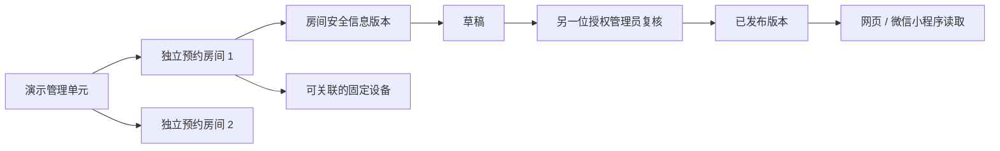

<div align="center">
  
  <h1>校园实验室设备预约与借用管理系统</h1>
  <p>设备借用 · 场地预约 · 现场交接 · 异常与维修追踪</p>
  <p><a href="https://campus-lab-equipment-manager.onrender.com/">打开网站</a> · <a href="docs/项目入口.md">网站与微信入口</a> · <a href="#快速开始">本机运行</a> · <a href="docs/分析报告/校园实验室设备预约与借用管理系统分析报告-宋明俞-1602240221-终稿.docx">分析报告</a> · <a href="models/ERD/分域ERD图册.pdf">数据模型</a></p>
</div>

[](https://github.com/yvming67-gif/campus-lab-equipment-manager/actions/workflows/ci.yml)

面向高校实验教学中心的课程演示项目。学生和教师通过网页或原生微信小程序查询资源、申请预约和查看进度；管理员通过网页处理审批、交接、异常和维修。两端复用Django领域服务与PostgreSQL业务记录。

> 使用模拟身份、资源与业务数据。免费云端闲置后会休眠，首次打开可能等待约一分钟；额度耗尽时接受服务暂停。微信公开版与网页分别管理，当前入口及访问条件见[项目入口](docs/项目入口.md)。真实学校认证、外部消息和正式发布不能由演示结果替代，详见[已知限制](docs/已知限制.md)。

## 资源结构与场地安全信息

网页和小程序的房间详情读取同一条场地档案；安全内容通过带来源、版本和复核期限的记录发布。当前没有经责任岗位批准的本项目安全材料，因此各房间明确显示待确认。



资源名称、地点、容量与设施均为课程模拟数据；真实实拍图需经过资源对应、授权和隐私核验后才可加入。玻璃效果为CSS/WXSS视觉近似，不是Apple原生组件。详见[图片来源与授权](docs/图片来源.md)和[案例研究与设计决定](docs/案例研究与设计决定.md)。

## 角色与能力

| 使用者 | 可完成的主要工作 |
| --- | --- |
| 学生、教师 | 查询设备和场地、选择候选时段、申请与取消、本人进度、补充说明、异常报告及通知 |
| 实验室管理员 | 管理范围内的预约审核、风险复核、设备借还、场地交接、异常核实、维修指派与验收 |
| 维修人员 | 有权维修任务的过程记录与结果提交；不能替代独立验收 |
| 系统管理员 | 用户角色、培训、基础参数和开放日历；不自动拥有业务审批权 |
| 实验教学中心主任 | 中心统计与只读审计 |

管理操作在网页办理。小程序是师生渠道，不提供管理员审批入口。申请、审批与实物交接分别留存，计划结束不等于实际归还。

## 快速开始

### 在线网页

打开[校园实验资源中心](https://campus-lab-equipment-manager.onrender.com/)进入共享演示环境。2026年11月10日只读复核时，线上身份选择页列出学生与教师演示身份；没有提交管理员密码或创建业务数据。仓库公开代码 `4d834d0` 已限制公开演示登录为学生和教师，但 Render 未公开可核实的运行提交号，因此本次不能证明云端精确运行了该提交，也没有完成管理员凭据的负向登录测试。公开演示密码为 **`Demo@2026`**。

| 账号 | 角色 |
| --- | --- |
| `student`、`student2` | 学生 |
| `teacher` | 教师 |

共享演示中的预约和取消会影响其他访客，请只填写模拟内容，不上传真实隐私、账号凭据或责任证据。公开演示身份选择页没有管理账号；代码还会在网页与小程序认证环节拒绝管理角色并使旧会话失效。由于尚未验证 Render 精确提交和管理员密码拒绝场景，完整角色流程请在本机隔离演示环境中查看。[按角色操作说明](docs/演示操作说明.md)

### Windows本机运行

1. 安装[Python 3.13 x64](https://www.python.org/downloads/windows/)，勾选“Add python.exe to PATH”。
2. 点击本仓库 **Code → Download ZIP**，完整解压。
3. 双击 **启动演示.cmd**。首次需联网、约2GB可用磁盘，并下载约364MB的PostgreSQL组件；无需预装Git、Node.js或数据库服务。
4. 使用启动窗口显示的地址，默认 `http://127.0.0.1:8000`；端口占用会自动选择空闲端口。

保留启动窗口；按 `Ctrl+C` 停止网页与后台，双击 **停止数据库.cmd** 停止本项目数据库。再次启动保留数据；私有配置在不提交的 `.local`，依赖在 `.venv`。[运行指南](docs/运行指南.md) · [已有PostgreSQL及开发检查](docs/开发与验证.md)

### 微信小程序

微信公开版尚在准备，实际平台条件见[微信发布说明](docs/微信发布说明.md)。源码在 `miniprogram`，公开配置使用 `touristappid` 占位；开发者在私有副本绑定账号。后端地址由开发配置固定，登录者不能更改。[小程序开发指南](miniprogram/README.md)

## 业务约定

- 学生和教师可申请设备，仅教师可申请整间场地；可移动设备独立预约，固定设备遵守关联场地限制。
- 普通设备规则检查后自动确认；受限设备与场地人工审批。待审核不占时段，但计入个人未来配额，批准前重新检查。
- 默认未来14天、30分钟粒度、同日最长8小时；按开放日历执行。每类未来预约最多3项，同时最多使用3台或套设备。
- 候选时段只是查询快照。资源、资格、冲突与配额由服务端在提交和批准时重新核验。
- 实际交接与计划分开记录；异常分级核实，维修执行与验收分离，恢复前检查全部限制。
- 状态历史只追加。站内通知与业务同事务保存，外部消息失败不得撤销已保存业务；未知结果重试保留原请求标识。

这些属于课程基线，不能据此推定某所学校已有同样制度。[需求与规约](docs/逻辑整改/README.md) · [接口契约](docs/接口与通道.md)

## 分析报告与数据模型

| 材料 | 入口 |
| --- | --- |
| 系统分析报告 | [可编辑Word报告（已通过LibreOffice分页与逐页视觉复核；Microsoft Word原生重排待确认）](docs/分析报告/校园实验室设备预约与借用管理系统分析报告-宋明俞-1602240221-终稿.docx) |
| 业务与需求基线 | [来源、组织价值、流程、29份用例规约及追踪](docs/逻辑整改/README.md) · [分析模型](docs/课程规范完善/README.md) |
| 数据设计 | [ERD与数据设计说明](docs/ERD与数据设计说明.pdf) |
| 矢量ERD | [完整总图](models/ERD/完整ERD总图.pdf) · [A4分域图册](models/ERD/分域ERD图册.pdf) |
| 可编辑模型 | [draw.io总图](models/图形源文件/ERD-00-完整实体关系总图.drawio) · [JSON、DBML、Mermaid、UML及离线交互图说明](models/README.md) |

当前模型含38个领域实体、327个字段和68条物理外键，框架会话表不计入领域ERD；新增场地级开放安排和安全规程版本。需求含29项系统用例、48条业务规则、DC-01恢复约束、11项质量需求和72项验收场景。静态引用一致不能替代业务运行验证。

## 技术与维护

Python 3.13 / Django 5.2 / PostgreSQL 17，网页采用Django模板，小程序采用原生JS/WXML/WXSS。常规网页运行无需前端构建。

```text
core/          领域服务、权限、接口、任务及测试
templates/     网页模板
static/        样式、交互与经许可后方可加入的项目资源照片目录
miniprogram/   师生原生微信端
docs/          正式分析、模型说明、运行与验证文档
models/        ERD及可编辑UML源文件
tools/         启动、校验、备份及恢复工具
```

[验证与验收摘要](docs/验证说明.md) · [开发与验证命令](docs/开发与验证.md) · [云端部署](docs/云端部署.md) · [备份恢复](docs/云端备份与恢复.md) · [免费额度策略](docs/云端免费额度与停用策略.md)

代码采用MIT许可；当前不打包第三方实验室照片。新增图片必须单独核对许可和资源对应关系，见[LICENSE](LICENSE)及[图片来源](docs/图片来源.md)。
