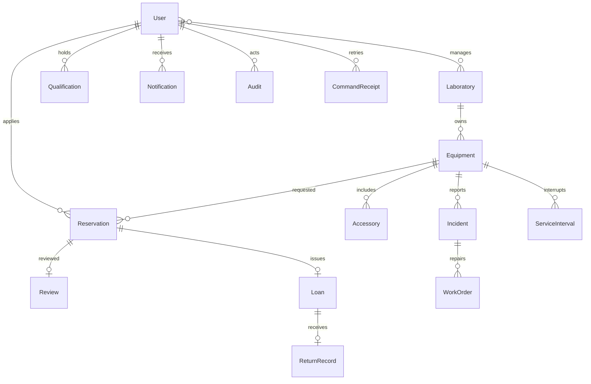

# 架构与一致性

单体 Django 应用，按职责划分：`identity` 认证适配、`models` 持久化、`services` 事务业务、`queries` 数据范围/统计、`views/forms/templates` 中文页面、`jobs` 数据库任务及模拟发送、management commands 后台和初始化。页面与 worker 复用服务层状态转换，页面没有通用状态修改入口，也没有开放 Django admin 作为业务演示替代。

## 数据关系

角色为用户的单一显式业务角色，不使用 `is_superuser` 绕过业务授权。业务参数单例行兼作事务闸门。Review/Loan/ReturnRecord 分别以 OneToOne 防止重复审核、借出和归还；设备开放借出具备条件唯一约束；配件名、用户资格、通知事件键、用户请求键唯一。预约有正时间区间检查、设备/个人状态时段索引，借用有逾期索引。

## 预约状态

|原状态|后续|执行者与条件|
|---|---|---|
|待审核|通过 / 驳回|授权管理员，开始前；必填原因；通过再次检查资格、逾期、设备/个人冲突|
|待审核 / 通过|取消|本人，开始前、必填原因；或异常/维护服务自动取消受影响未开始预约|
|待审核|失效|worker，到开始时间未批|
|通过|失效|worker，到领取宽限边界未领|
|通过|借出中|授权管理员，领取窗口内，身份/标签/配件/功能检查，无阻塞|
|借出中|已完成|授权管理员归还，保存接收时间、接收人、检查、逾期秒数|
|驳回 / 取消 / 失效 / 完成|无|终态，不提供重新打开入口|

异常：待确认 → 已确认待解决 / 已解决；已确认待解决 → 已解决。存在开放工单不能直接解决。维修：待处理 → 处理中 / 待验收；处理中 → 待验收；待验收 → 已关闭 / 处理中。仅被指派维修人员填写结果，授权管理员独立验收。

设备三个维度分开：`physical` 在库/借出中；`service` 正常/隔离/维修/停用/报废；时段可用性由预约、实际未归还借用和服务状态动态计算。异常不能改写在借实物事实。正常恢复要排除其他未解决异常、其他开放工单、停用报废和任何未归还借出。异常归还后历史 Loan、ReturnRecord 一直保留。

## 事务和并发

每个业务写命令：`transaction.atomic` → 锁定 BusinessConfig 主键1 (`SELECT FOR UPDATE`) → 读取最新操作者/业务对象 → 检查幂等收据 → 权限/规则 → 业务行+审计+通知任务+幂等收据 → 一次提交。所有写流程锁顺序一致：单例闸门在先，不持有其他业务锁后再等待闸门。设备、资格、个人额度和时间冲突检查均在持锁事务中完成，不使用 Python 内存锁。后台失效/提醒同样先取得闸门。

这是有意采用的课程规模设计：**串行化业务写入，查询不锁闸门**，因此管理员同时批准重叠预约只有一个事务能成功；个人额度和维护竞争也被保护。数据库条件唯一约束作为借出重复防线。事务异常完整回滚，包括审核记录、异常归还、审计、通知、请求收据。测试用独立 PG 连接、线程屏障与真实同时发起事务验证，不用 SQLite，也不把顺序调用描述成并发。大规模吞吐需要进一步按用户/设备拆分锁并加入更严格的时段数据库排斥约束，此项未宣称完成。

幂等标识为表单生成 UUID，用户+UUID 唯一，操作名称及规范化参数 SHA256 一致才返回原对象。另一个账号的 UUID 空间独立。同一个 UUID 不同参数拒绝；没有成功提交的事务不保存收据。保留收据与历史相同生命周期。重试时仍需当前账号有效；页面数据范围在加载对象时检查。

审计和业务状态同事务；数据库 trigger 拒绝审计 UPDATE/DELETE，普通用户无写历史入口。数据库所有者仍属于可信运维边界，不能把数据库管理员防篡改当作已实现。

## 后台与通知

站内通知由 Notification 行即时提供；外部发送由独立 worker 领取。任务先短事务 `select_for_update(skip_locked)` 取得两分钟租约和 UUID，提交后调用模拟服务，再短事务确认租约更新结果。进程故障后过期租约可恢复；过期执行者无法确认新租约。模拟服务以 event_key 唯一写 MessageDelivery，实现相同事件重复投递不重复生效。真实服务若未来接入，也必须支持同一幂等事件键，否则只能保证至少一次调用。

首次发送与重试区分：attempts=1 表示首次结束；失败后1/5/15分钟，attempts=4最终失败。发送错误不影响已提交预约。通知包含预约结果、维护影响、临近一小时归还、逾期，提醒事件键由借用编号+类别确定，重复调度不会新增。任务命令 `--once --at` 支持可控时间，生产页面不接受客户端业务时钟。

## 统计与运行

利用率周期采用选择日期起00:00至结束日次日00:00（上海时区），截断至当前。分母为设备日历时长减去 ServiceInterval 中异常/维修/停用/报废时长；分子为实际借出至实还/当前，与周期相交并扣相同服务中断。状态从正常离开时新建中断，恢复时结束，服务中断不重叠。停用全周期分母0则展示0%。仅反映模拟设备，不推断真实利用率提升。

Windows 便携 PostgreSQL、两个独立 Python 进程；Compose 提供数据库/应用/worker，按健康检查排序。UTC 入库，上海显示。模拟种子不删除数据，相对初始化时间生成；reset 工具只收尾严格限定模拟范围且保存全部历史。所有密钥、密码、本地数据库、备份及个人文档均忽略。
