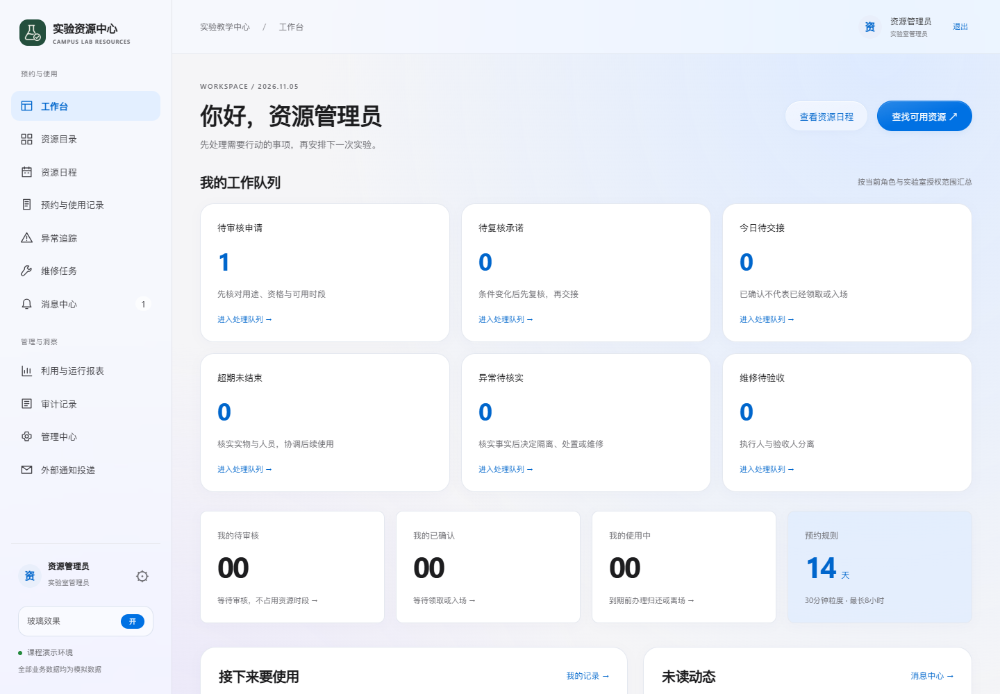
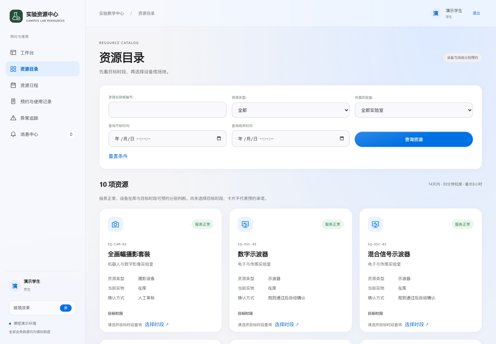
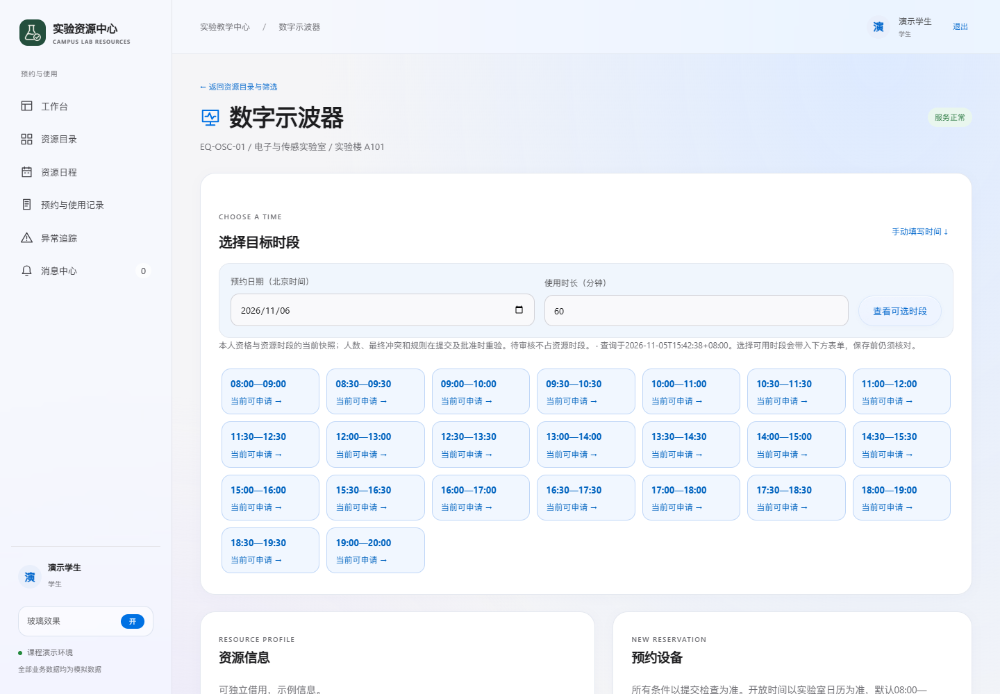
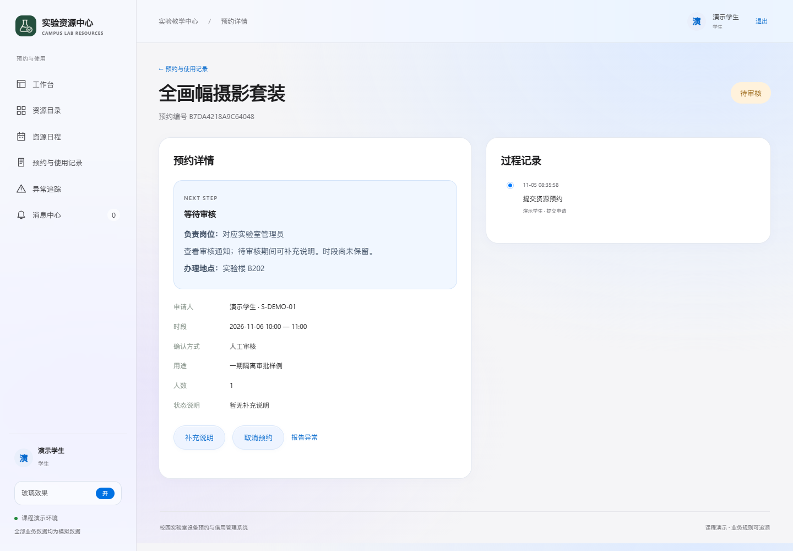
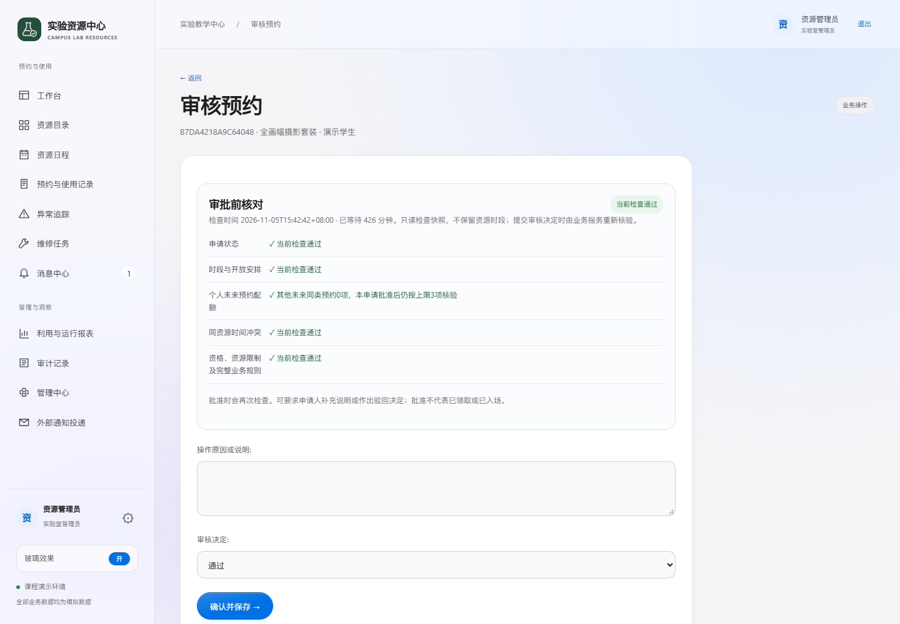
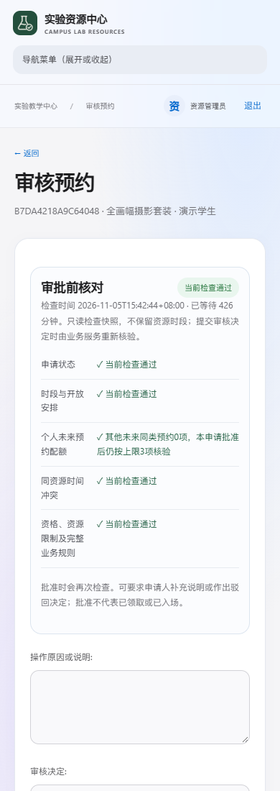

# 一期体验与小程序通道改进

2026年11月5日，在`39634093`基线上完善资源选时、管理员审核信息和申请人下一步指引；小程序新增的补充说明与文字异常入口承接原UC-06、UC-13，不新增业务制度、角色或数据实体。

|改进|当前行为与限制|
|---|---|
|资源信息|分别表达服务、实物、目标时段及审批方式，按类别显示图标|
|选时|候选附检查时点和不可选原因，可带入真实申请表；提交仍实时检查|
|审核|网页队列按等待排序，单笔展示资格、配额、开放和冲突；最终决定重检，不能审本人或越范围|
|进度|展示岗位、实际登记地点、后续操作及最近100条范围；未知地点不编造|
|小程序补充与异常|复用现有领域事务，归属和权限在服务端核查；未知结果保留原请求核对，不新增附件接口|
|视觉|保留局部玻璃、减少动态和不支持模糊时的降级；正文与表格保持稳定背景|

## 真实网页画面

以下均为本期隔离本地Django/PostgreSQL、模拟数据的真实浏览器截图。手机图为390像素浏览器视口，不是手机微信截图。

|工作台|资源目录|
|---|---|
|||

|候选选时与表单|预约下一步与沟通|
|---|---|
|||

|桌面单笔审批|手机网页审批|
|---|---|
|||

## 验证与材料

- [验证记录](验证记录.md)：275项后端回归（3跳过）、102项客户端检查、8页编译、44次响应式观察、HTTP联调及各自限制。
- [独立复核](独立复核.md)：反例测试、截图观察、五类独立发现及修复后的范围。
- [完整问题记录](问题记录.md)：AUD-0119至0126，共8项；[机器台账](问题记录.json)保留全部字段。
- [需求与数据通道契约](需求与数据通道契约.md)：原规约承接、接口字段、只读快照、幂等和历史读取边界。
- [文档同步](文档同步.md)及[Word核验](文档核验.json)：业务数量不变，正式报告104页最小同步。

本期未以编译或控制器模拟替代微信原生容器和Android新功能验收；iPhone延期，名称审核待平台证据，正式发布未由本地检查证明。云端实际部署版本和手机包需各自核对。二期建议依次评估收藏/最近使用、资源二维码、按需求导出，再评估深色模式；尚未开发，不加入候补、续借、收费或批量审批制度。

发布后的GitHub三项自动检查、云端文件/接口实测及本期小程序样式预览已补充至[发布记录](发布记录.md)。原生容器、新包手机验证及正式发布仍未完成。
