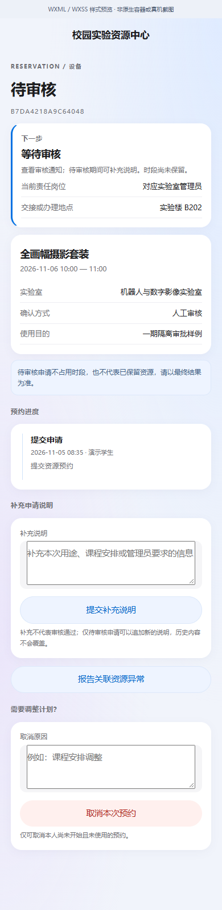
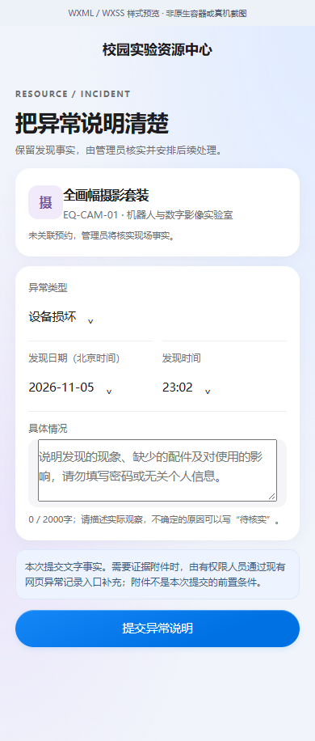
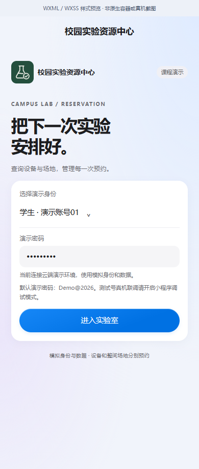
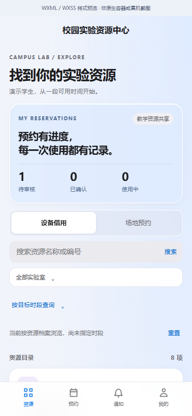
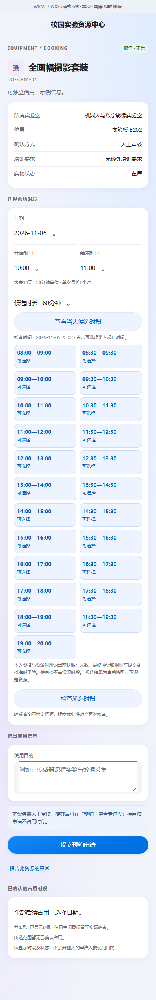
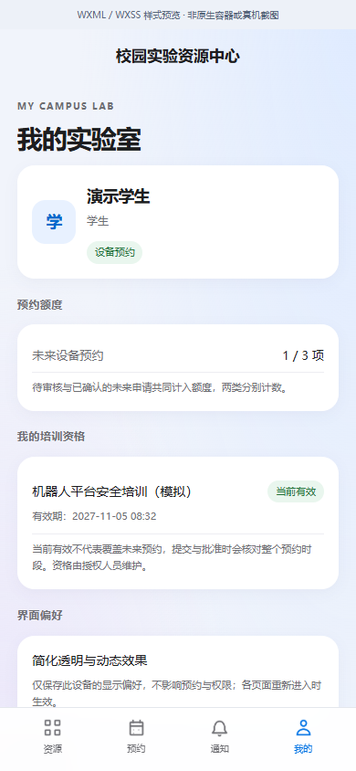

# 一期发布及验证状态

2026年11月5日。运行代码提交：`e03ae75dd74799c396f966f1fd36b3816e872157`。基于`39634093`，保留既有Django/PostgreSQL、网页模板和原生小程序架构。

## GitHub与云端

已正常推送main，没有强制覆盖历史。[本次自动检查](https://github.com/yvming67-gif/campus-lab-equipment-manager/actions/runs/42049608841)三项均成功：

- 业务检查：275项后端测试，3跳过；六组客户端合计102项通过；8页WXML/WXSS编译；需求与模型注册、迁移漂移检查。Linux启动工具测试11项中2项Windows专用检查跳过，不能归入275项的跳过统计。
- 云端配置：8项配置检查及6项TLS PostgreSQL集成检查通过。它们是隔离CI环境，不是Neon和对象存储联合灾后恢复。
- Windows首次安装：GitHub托管Windows Server 2022的中文含空格目录中，两次安装/启动冒烟、11项启动测试与本机归档恢复通过。恢复样例附件数为0，不等于实际云端附件恢复，也不等同于每台Windows 10/11实体电脑均验证。

[在线演示](https://campus-lab-equipment-manager.onrender.com/)已实际访问。界面CSS及交互JS的SHA-256与本地一期文件相同；以学生模拟身份读取新候选接口，返回23个时段及检查时间，随后退出会话。未创建共享云端预约、异常或审批。证据见[云端只读核对](证据/cloud-verification.json)及三个`ci-*.json`摘要。未取得Render管理页部署提交回执，因此结论是“线上文件及新接口已匹配”，不冒称查看过Render部署日志。免费资源及额度策略不变。

## 小程序包与图片

本期六张小程序图片来自当前WXML/WXSS、实际控制器和隔离本机接口；每张顶部标明浏览器映射，不是原生容器或真机。只执行读取和模拟登录退出，没有为图片创建业务记录。图标、输入控件、选择器及开关的显示与交互细节仍以微信容器为准。图片见下文，来源记录见[生成记录](证据/mini-style-render.json)和[浏览器截图记录](证据/mini-style-capture.json)。

|预约指引与补充说明|文字异常报告|
|---|---|
|||

|登录|资源目录|候选时段|个人中心|
|---|---|---|---|
|||||

私有云端预览副本已准备，除个人项目绑定外51份源文件与公开小程序一致，不将绑定写入仓库。官方CLI实际返回“IDE service port disabled”，当前工具登录已失效；因此本期未生成新官方预览码、未上传开发版本、未完成Android新版业务操作。此前工具恢复打开的是10月27日旧副本，不能算本期容器验收。账号名称审核未查询，iPhone继续延期。

后续需在微信官方工具扫码登录并于“设置→安全设置”开启服务端口，再打开本期副本、读取当前编译提示、验证原生容器、生成新预览并执行Android场景。合法域名、开发预览、上传、体验版和正式发布各自记录。无需提供AppSecret或密码；不绕过平台登录。

## 验证辅助程序的更正

第一次云端核对脚本将`product.css`误归为`product.js`而报告不匹配；按文件名及扩展名精确匹配后，CSS、JS均与本地一致。首次样式导出在最后退出时错用了辅助接口参数，前端页面已生成但导出未完成；改用实际logout方法后重新执行成功。两项为核验工具问题，不是应用缺陷，原失败与更正保留私有目录。期间隔离数据库重新启动需提升进程权限，首次未启动，不计产品失败或测试通过。

这些后续结果补充[本地验证记录](验证记录.md)；不会将跳过、未执行或历史手机确认改写为全部通过。
