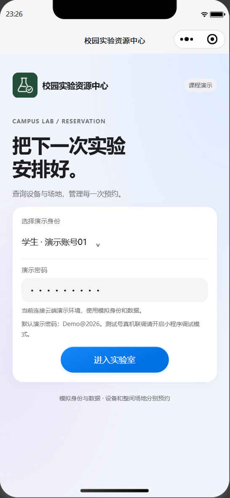
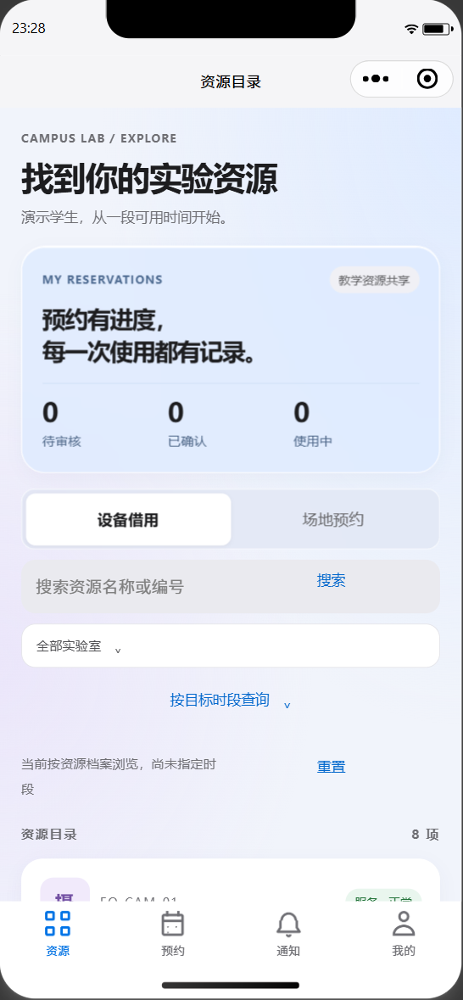
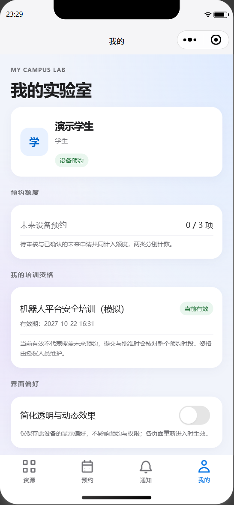
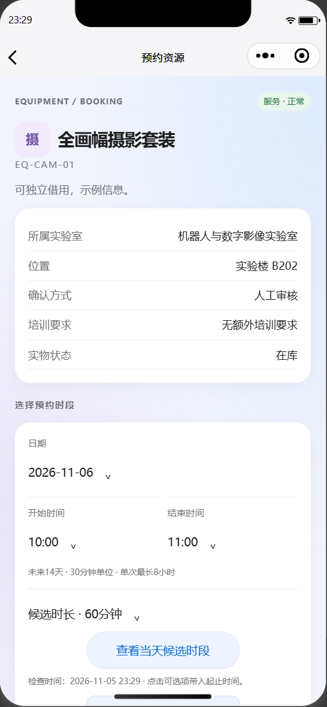
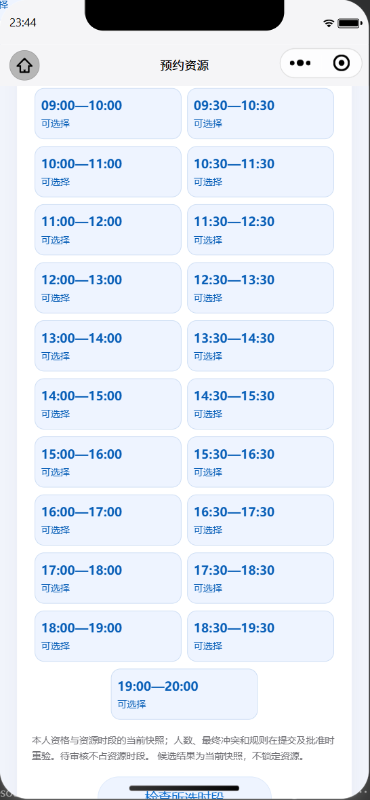
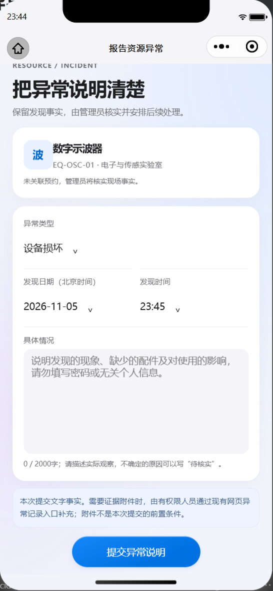

# 微信新版预览与原生复验

2026年11月5日晚。在用户开启官方服务端口后，CLI确认登录成功，打开一期私有副本，完成原生自动化及官方预览。公开项目继续使用通用绑定，临时预览码和个人配置不进入仓库。

## 实际完成与边界

- 原生平台为`devtools`，SDK3.17.6，逻辑窗口390×753。外框显示iPhone模型，是开发者工具模拟器，不是iPhone真机验收。
- 使用真实云端查询，资源目录读到8项设备；目标日期取得23个候选，实际点击后表单08:00—09:00与候选一致。
- 实际打开资源、异常说明、个人中心。异常表单滚到底后按钮完整可见；空说明点击返回“请填写1至2000字的具体情况”，没有保存异常。没有创建预约、审批或异常业务记录。
- 发现390px原生候选列表错误单列，登记AUD-0127。修前按钮184px、前两项不同排；修改布局后按钮154.875px，前两项纵坐标一致，实际截图为双列。340px以下降级条件仍保留，但本次未追加该宽度的原生运行证据。
- 布局修正版通过8页WXML/WXSS检查，并再次由官方工具生成预览。预览会将代码传至微信预览服务；没有执行`cli upload`开发版本上传，没有设为体验版或正式审核发布。包体及文件摘要见[预览证据](证据/native-preview.json)。

Android用户对本期首个预览反馈：“能登录，两个入口都能看到”。它证明当时包的登录及候选、异常入口可见；不等于已验证异常提交、补充说明、预约审批、通知、断网恢复或全部效果。随后CSS布局修正版已重新生成，手机显示确认仍需独立记录。iPhone继续延期，账号名称审核未查询。

## 原生容器画面

以下六张来自微信官方开发者工具，使用模拟身份与真实云端接口；不是手机照片，也不是浏览器映射。另保留[浏览器映射图片](发布记录.md#小程序包与图片)作为先前设计证据，不相互冒充。

|登录|资源目录|个人中心|
|---|---|---|
||||

|资源详情|修正后双列候选|滚到底后的异常表单|
|---|---|---|
||||

## 辅助尝试与更正

首次`Page.callMethod`报`this.submit is not a function`，后续登录按钮实际触摸及资源读回成功；直接方法调用不能替代页面事件验证。首次17.5秒等待到期后，后续实际读回已有8项资源，不把该等待到期写成应用登录失败，亦未据此推断冷启动时长。原始失败保留为`native-method-attempt.json`与`native-short-wait-attempt.json`。

初次候选记录在事件尚未完成时未取到数量；后续严格等待候选结果，并以`native-slot-result.json`确认23项及实际选择，后者为选时验收依据。预览重新编译后自动化连接需要重连，测量超时不计为产品失败。直接方法调用`loadSlots`也发生同类辅助异常，改用真实按钮后完成测量。

官方CLI仍输出其内置Node的`punycode`弃用警告；本次成功输出没有提供此前两项构建提示的明细，因此不宣称两项提示均已修复。模板编译、原生部分路径、Android局部反馈及正式发布的证明范围继续分开。
