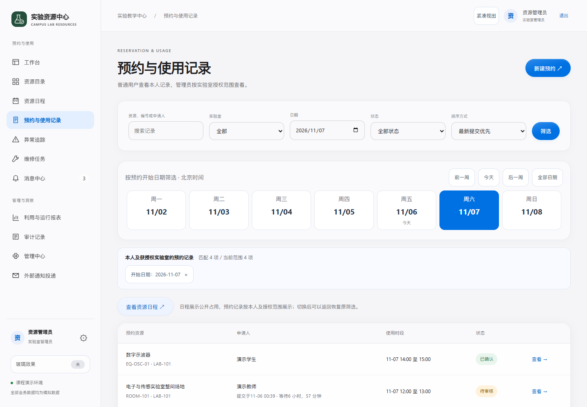
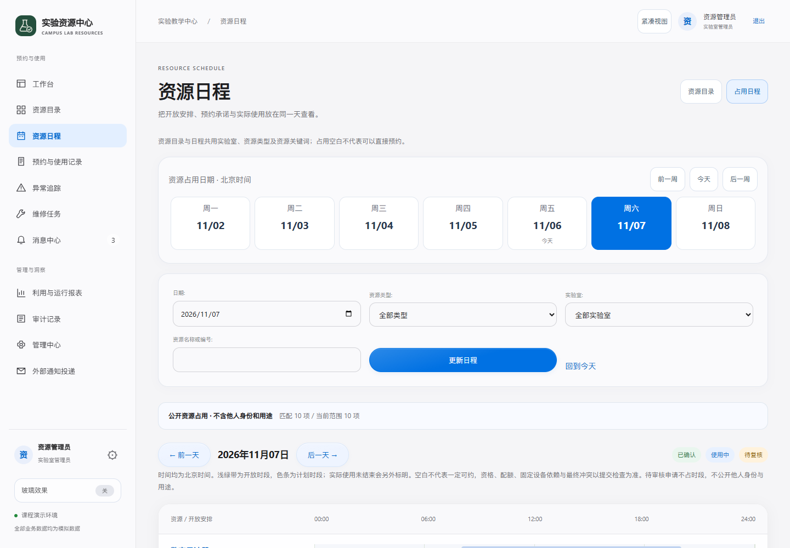
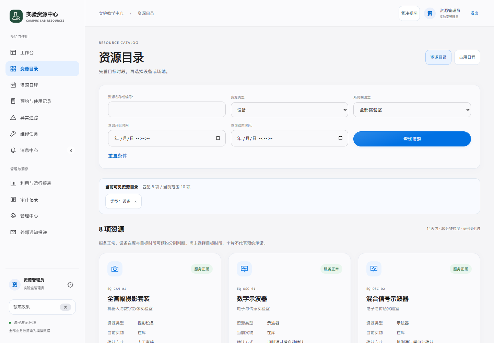
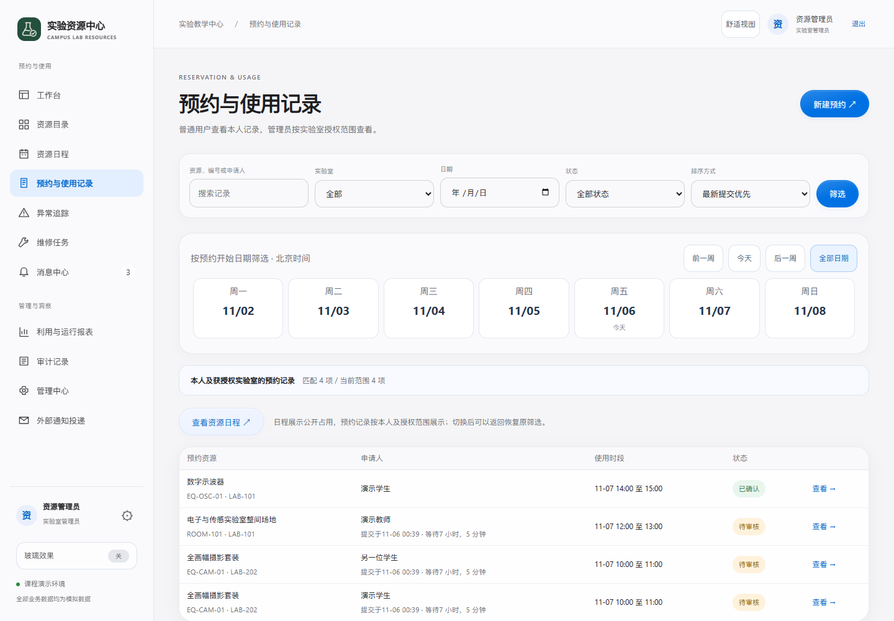
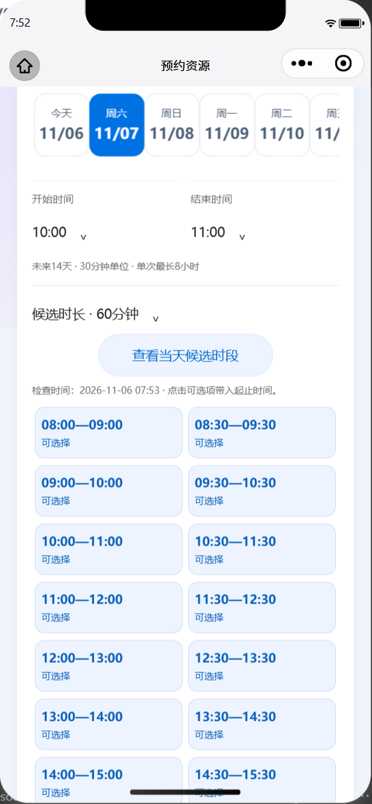

# 日期、查询与显示密度改进

2026年11月6日，在12536f4基线上落实[参考研究](../界面设计/参考研究-安德鲁牙科.md)的四项界面组织方式。沿用现有校园领域服务、权限、苹果风格与局部玻璃，不复制牙科实体、图片、代码或制度。

|项目|实际变化|边界|
|---|---|---|
|REF-01 日期快捷导航|网页预约记录/日程显示所选周；小程序查询/详情显示近期七天，选择后旧候选失效|历史浏览与申请窗口分开；原14天、30分钟、最长8小时规则不变|
|REF-02 视图联动|资源目录与日程保留资源条件及原起止时段；记录进入公开日程后可返回恢复原筛选|公开日程不显示他人身份/用途，不把私人记录关键字当成资源搜索；换账号不恢复原账号上下文|
|REF-03 查询摘要|网页显示有权范围与匹配数量，单项清除；小程序摘要绑定上次成功请求|未提交草稿、失败请求不冒充已应用结果；清除一项保留其他已应用条件|
|REF-04 桌面紧凑视图|有权工作人员宽屏可切换表格/筛选密度，刷新保留|显示偏好仅保存在当前设备；手机网页隐藏，学生保留舒适视图，不改变授权|

## 真实画面

|预约记录与周导航|公开占用日程|
|---|---|
|||

|资源目录及摘要|桌面紧凑视图|
|---|---|
|||

以上为隔离本地Django/PostgreSQL、模拟数据的真实浏览器截图。另有320/390/768/1440宽度检查，不等于实体手机验收。

|微信查询摘要与清除|微信日期与候选|
|---|---|
|||

微信图片来自官方开发者工具SDK3.17.6、390逻辑像素模拟器及真实云端只读查询，不是Android或iPhone真机。日期按钮已按原生实测修正；未创建共享云端预约。模拟器外观采用iPhone机框也不代表执行过iPhone验收。

## 交付记录

[验证及限制](验证记录.md) · [问题完整台账](问题记录.md) · [独立复核](独立复核.md) · [需求与实现对应](需求对应.md)。四项新增问题AUD-0128—0131均按注明范围关闭，历史问题没有删除。微信新包、网页远端发布和手机确认分别取证，不能用GitHub提交替代安装或正式审核。
