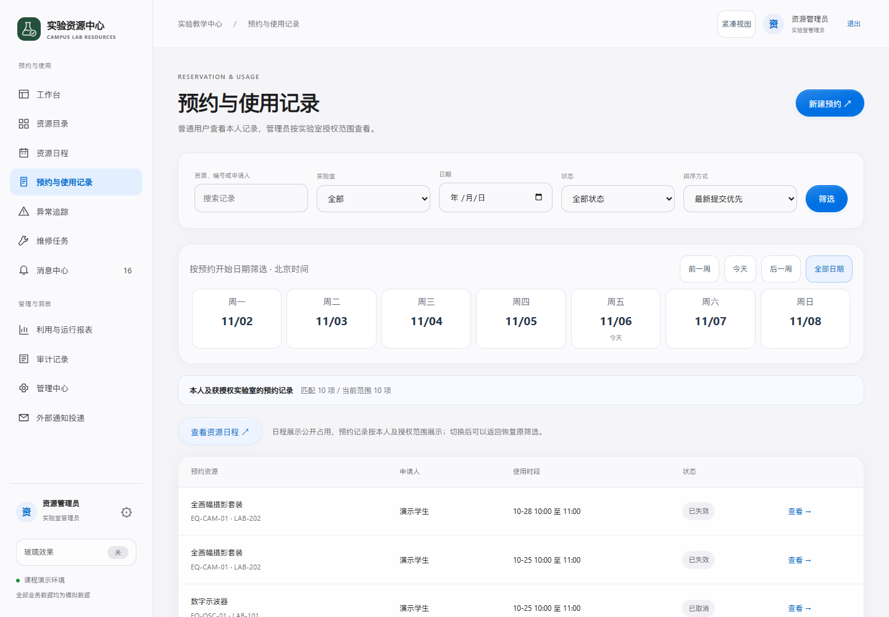

# 本轮包与发布记录

2026年11月6日，在main/12536f4基线上完成日期、视图往返、摘要与工作人员密度显示；变更不包含数据库迁移、业务规则修改或新服务费用。

## 小程序

已通过微信官方CLI生成本轮新预览包，大小154952字节（151.3KB）。私有副本51个源文件与公开miniprogram逐字节核对，只有项目账号绑定配置不同；源文件摘要见证据/mini-source-receipt.json。个人AppID、临时二维码、私有配置、密钥不入公开仓库。预览成功不是cli upload、体验版或正式审核发布；本轮Android尚待打开确认，iPhone继续延期，名称审核未读取。

官方容器已实际读云端、点选日期、查询/清除时段条件和获取候选；没有提交预约、审核、取消或异常。官方CLI仍有其自身punycode弃用告警，未冒充项目编译错误或宣称全部历史工具提示已解决。

## 网站与GitHub

本地验证及独立复核完成后发布，云端必须通过部署后的静态文件摘要和真实接口读取单独核对。发布提交、远端CI与云端实际结果在取得证据后追加，不以此说明自动宣称已经上线。

## 远端实际复核追加

功能提交：[3a8ba2c](https://github.com/yvming67-gif/campus-lab-equipment-manager/commit/3a8ba2c48d9ff4262875f513303342e0e140c8c1)。对应[GitHub自动检查42133183634](https://github.com/yvming67-gif/campus-lab-equipment-manager/actions/runs/42133183634)三项全部成功：PostgreSQL业务、Windows中文空格路径首次安装、云配置集成。结果仅覆盖此运行所执行场景。

北京时间2026年11月6日07:58后，Render公开登录页返回200，interface.css和product.js两份文件SHA-256与当前本地完全一致；公开模拟登录后真实资源及候选接口200，23项候选，已退出会话。首次核对仍是旧文件的结果也保留于cloud-before-deploy.json，未当作新版通过。核对未新增费用或改动账单。

随后在实际在线站点登录公开模拟管理员，核对资源、预约记录、日程三页的新查询摘要、密度入口和七日导航；1440px无整页溢出，保存真实云端截图并退出。网页源码及接口证据分别记录，不声称这次只读检查等于所有写流程验收。

此图为实际Render网页与共享模拟数据，不是静态设计稿。最后的证据/说明提交使用[skip render]，不再耗用一次运行部署；网站运行功能仍是3a8ba2c。GitHub首页新图已同步。官方小程序新预览码保留本机，手机不会随Git推送自动换包。
