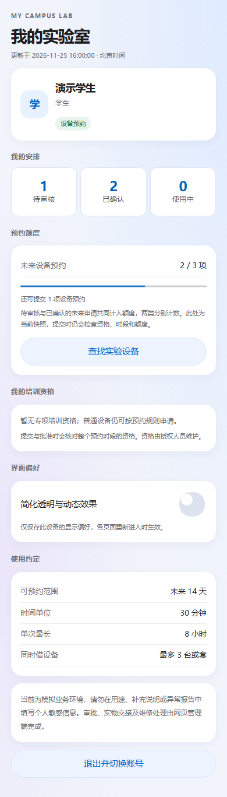
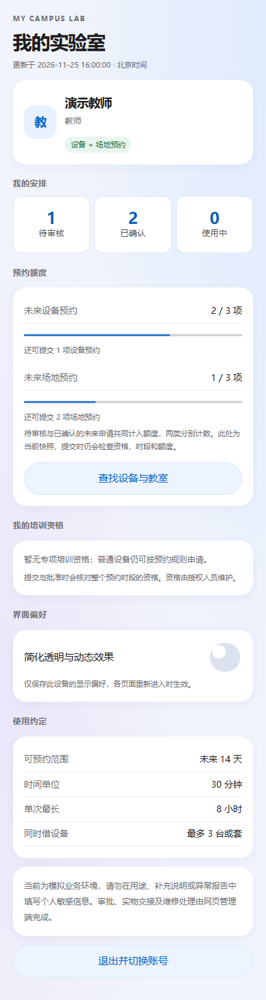

# 2026年11月25日小程序优化与验证

## 变更依据与范围

基线：main，73347cdeae4896d27dcf51e754fbdbb50cd25904，开始时工作区干净。用户确认备案已通过，登记名称为“青序实验设备簿”。保留网页“校园实验资源中心”品牌与原生微信小程序架构；没有新增领域规则、接口、实体、数据库迁移、付费服务或后台轮询。

| 编号 | 分类与实际问题 | 处理与位置 | 验收 |
| --- | --- | --- | --- |
| MP-20261125-01 | 发布体验：登录页与域名错误仍引导普通用户开启测试号调试 | config.js、app.json、登录页、utils/api.js同步名称，替换为维护指引 | 正式域名校验保持开启；错误不引导关闭安全检查 |
| MP-20261125-02 | 已确认缺陷：相同预约查询刷新前清空结果，离线后失去已读取列表 | controllers.js bookings保留同查询快照并标出过期；不同查询清空旧结果 | 离线保留、恢复替换、换筛选失败不混入旧数据 |
| MP-20261125-03 | 已确认缺陷：个人页并行读取缺少请求序号，较早响应可覆盖新结果 | controllers.js profile增加请求序号和账号切换失效处理 | 成功/失败乱序、切换账号、旧响应不更新角标 |
| MP-20261125-04 | 体验改进：个人进度与额度不易定位 | 个人页显示三项本人进度、按角色额度条、北京时间读取时间与下拉刷新 | 指标点按转到既有状态筛选；额度保留数值、缺失值不当零 |
| MP-20261125-05 | 体验改进：已取得未读汇总未用于底栏提示 | 首页、个人与通知读取后更新通知角标；退出清除 | 99+封顶、零值清除、账号变化和失败不伪造新数据 |

“我的”数值来自既有 /api/mini/v1/me/，通知来自既有通知接口。额度条是现有规则的可视化，剩余数字不保证资格、时段或交付条件已经满足；实际提交仍由服务端检查。新增动效只用于品牌和身份区，时长220毫秒，支持系统减少动态效果与手动简化开关。没有周期请求或新的统计采集。

## 自动化与样式检查

环境：Windows、Node.js 24.16.0；后端接口与数据库模型未改动。

| 检查 | 步骤和预期 | 实际结果 |
| --- | --- | --- |
| 客户端回归 | node --test tools/mini-check/*.test.cjs | 136项通过，0失败；其中8项为本轮新增，覆盖离线、竞态、账号归属、额度、角标及域名提示 |
| WXML/WXSS | node tools/mini-check/compile.cjs，编译全部原生页面 | 8页通过；使用miniprogram-compiler 0.2.3的wcc/wcsc检查 |
| 视口样式预览 | 将实际WXML编译树及WXSS映射到独立无窗口Chrome，注入明确的模拟数据；学生、教师、登录各检查320/390/768 CSS像素 | 9个场景未发现整页横向溢出；按钮测量最小44 CSS像素 |
| 视觉检查 | 查看390像素学生个人页、320像素登录页及教师预览 | 进度三列、额度文字与图形、登录名称与图标显示；浏览器适配层不能证明原生布局完全相同 |
| 减少动态效果 | 检查手动简化和系统prefers-reduced-motion覆盖，既有偏好测试继续通过 | 关闭入场动画与按压位移；没有循环动画；原生系统设置仍需真机复验 |
| 工作区检查 | git diff --check | 无空白错误；部分文件仅提示CRLF转LF |

样式预览截图由实际模板生成，使用模拟数值，不是微信原生容器或Android真机截图：

| 学生个人页 | 教师个人页 |
| --- | --- |
|  |  |

[登录页样式预览（320像素，模拟数据）](../images/mini-20261125-login-style.png)

## 微信工具、上传与外部验证

2026年11月25日通过微信官方CLI确认开发者工具已登录，并从不提交的独立副本上传 **1.5.0** 开发版本。官方CLI返回“√ upload”，包体186340字节（约182.0 KB）。副本绑定现有账号、开启urlCheck；公开源码继续使用touristappid，不提交个人AppID、私有配置、上传回执或临时二维码。

| 环节 | 当前结果及边界 |
| --- | --- |
| 名称与备案 | 用户确认名称“青序实验设备簿”、备案通过；客户端已同步。尚未独立读取公众平台备案状态 |
| 源码与语法编译 | 通过；不等于真机通过 |
| 官方开发包上传 | 1.5.0上传成功；上传不等于已设体验版、提交审核或正式发布 |
| 新版原生容器 | 未通过本轮验收。自动化连接读到旧名称“校园实验资源中心”，确认连接仍指向旧包；没有把旧包操作计为新包通过 |
| Android新包 | 本轮未执行；以往局部确认不外推至1.5.0 |
| iPhone | 按既有决定延期 |
| 合法域名 | 发布源码urlCheck为true；历史后台已配置HTTPS地址，当前后台及非调试真机仍待核实 |
| 代码审核、正式发布、普通用户搜索 | 本轮未执行或核实，不能由备案通过或上传成功推断 |
| GitHub与云端 | 客户端源码及说明随本轮提交同步；后端业务代码未改，GitHub更新不代表手机已更新 |

为遵守用户“后台工作、不干扰前台”的要求，没有切换或置顶窗口来修复模拟器连接，也没有要求当场扫码。后续在版本管理中选1.5.0核对体验版与Android流程，确认合法域名、隐私保护指引和审核材料后，再办理代码审核及正式发布。只有未加入体验名单的用户实际搜索并进入后，才标记为公开可用。

本轮没有修改Word、课程规约、ERD或字段字典，因为业务规则、用例职责、接口和数据结构没有变化。历史验证记录保留。