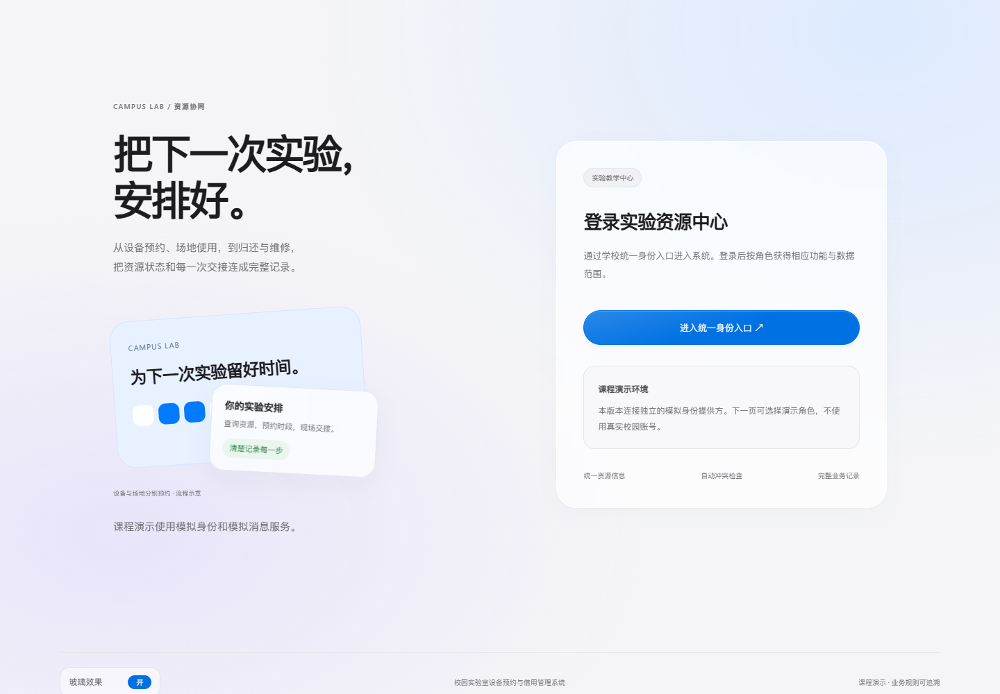
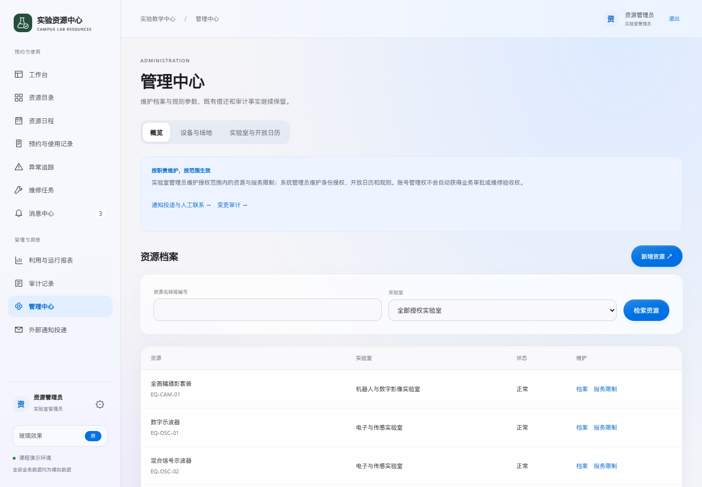

# 界面与交互设计

2026年10月27日更新。基线为7dccb20977ad364bc012198259b0bd475e8d0823。本次调整网页与原生微信小程序的视觉和轻交互，保留设备、场地、预约、审批、交接和维修的既有规则。正式分析报告、需求编号与数据模型未改动。

## 视觉语言

采用接近iOS的系统字体、浅灰底色、蓝色主操作、连续圆角与细边缘高光。保留项目已有墨绿烧瓶标识。玻璃表面由低饱和环境色、半透明底色、局部模糊和内侧高光组成；表格保持较实的背景，避免密集数据透底后难以辨认。使用系统字体，无外部字体或图片服务依赖。

视觉参考：[Apple Materials](https://developer.apple.com/design/human-interface-guidelines/materials)、[Apple Layout](https://developer.apple.com/design/human-interface-guidelines/layout)。本项目采用CSS/WXSS实现视觉近似，未接入Apple原生Liquid Glass组件。

## 适当的交互

|位置|反馈|业务边界|
|---|---|---|
|网页玻璃效果开关|侧栏底部可切换开启与关闭；手机在展开的导航菜单内；未登录页在页脚|仅保存当前浏览器的外观偏好，不改变账号权限或业务记录|
|网页交互卡片|精细指针设备下轻微上浮，柔和高光跟随指针|提示可进入的队列或资源，触摸设备不依赖悬停|
|网页按钮与表单|按压反馈、提交时旋转提示；返回页面时清除旧忙碌显示|不禁用有名称的提交按钮，不改变提交字段和值，不代替服务端幂等校验|
|手机网页导航|首次小屏收起，跨断点切换；同一断点内保留手动展开/收起|键盘可以操作原生details控件|
|小程序按钮与卡片|原生hover-class按压缩放与色调反馈；加载及禁用继续使用既有业务状态|保留全部原绑定、请求和页面控制器|
|小程序分段与底栏|选中状态、轻量过渡、四组自有线性图标|设备与场地资格仍由原控制器及后端判断|

首次访问网页默认尊重系统“减少透明效果”。用户可以主动开启玻璃效果，并在当前浏览器跨页面保留选择；关闭后使用不透明表面。不支持backdrop-filter时保留清晰实色卡片。“减少动态效果”会关闭浮动、跟随高光和旋转动画，忙碌语义及按钮反馈仍保留。小程序根据WXSS能力逐步增强，无法模糊时使用实色底及边缘高光；当前更新后的原生容器和真机兼容性仍待验证。

## 网页实际画面

以下为隔离本机Django/PostgreSQL模拟环境中的实际网页，截图时主动开启玻璃效果。模拟数据不代表真实学校使用记录。

|登录页|资源目录|
|---|---|
|||

|资源日程|管理中心|
|---|---|
|||

手机网页：[390像素资源页](web-mobile.png)。主要页面另以320像素宽度检查。

## 小程序样式预览

下图使用项目实际WXML/WXSS，经官方模板编译器输出后映射为浏览器布局；数据来自实际页面控制器调用的隔离模拟API，没有写入新预约。图片顶部注明来源。**它们属于样式预览，不是微信原生容器或真机截图**，不能据此判断原生渲染、iOS/Android触摸、键盘遮挡或正式微信域名已验收。

|登录|资源|个人中心|
|---|---|---|
||||

原生小程序本轮已更新全局WXSS、七页触摸反馈与底栏图标，并通过七页官方编译。官方自动化接口尝试超时，后续独立诊断实例停留登录页，因此没有将本轮原生容器验证记为通过；历史容器结果不替代新样式验证。手机验收保持暂停，iPhone延期。公开仓库保留touristappid，无个人AppID或AppSecret。

## 验证与限制

网页完成登录页1次及11个主要管理页面在1440、390、320像素宽度的33次检查，共34次；受保护页面同时核对已登录状态，未发现整页横向溢出或损坏图片。实际检查玻璃开启/关闭、跨页面保留、卡片高光、手机菜单和表单提交忙碌反馈。表单检查为DOM事件检查，没有执行预约、审批或维修写入。详见[界面验证](界面验证.json)。

客户端80项回归、七页WXML/WXSS编译及网页交互脚本语法检查结果见[回归记录](回归记录.json)。本轮没有真实校园调研、生产负载、全浏览器或完整无障碍认证；轻量视觉检查不替代这些验收。最初导航尚未完成、系统减少透明效果以及开发工具超时分别保留为未通过尝试，不计入最终成功次数。
