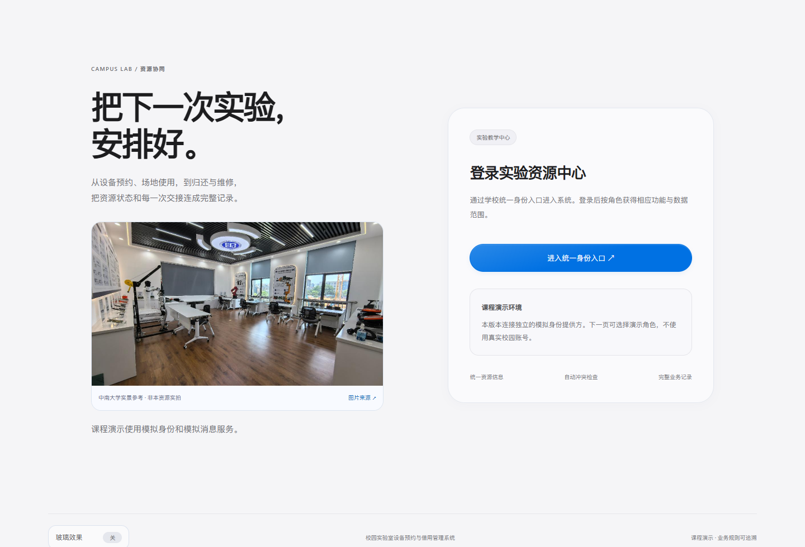
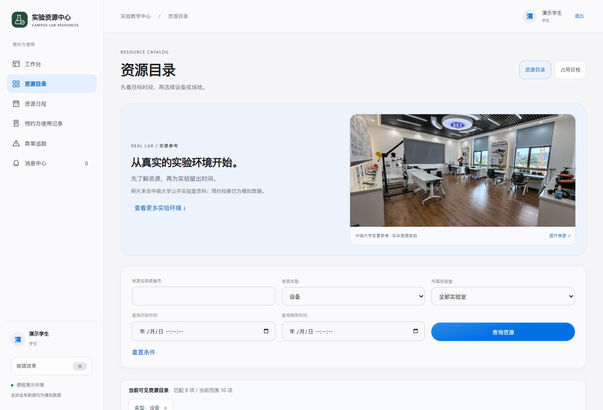
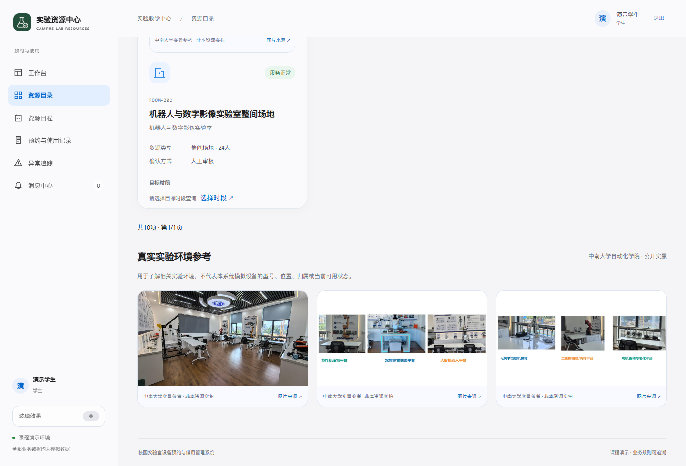
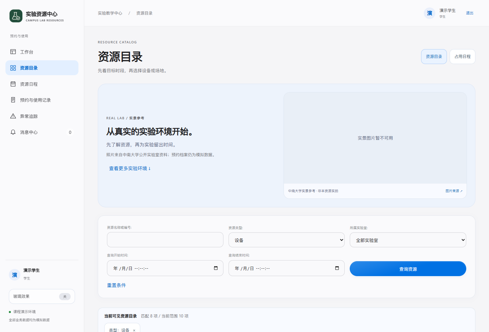
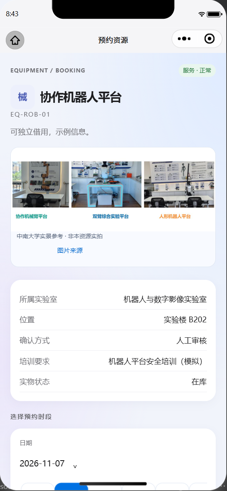
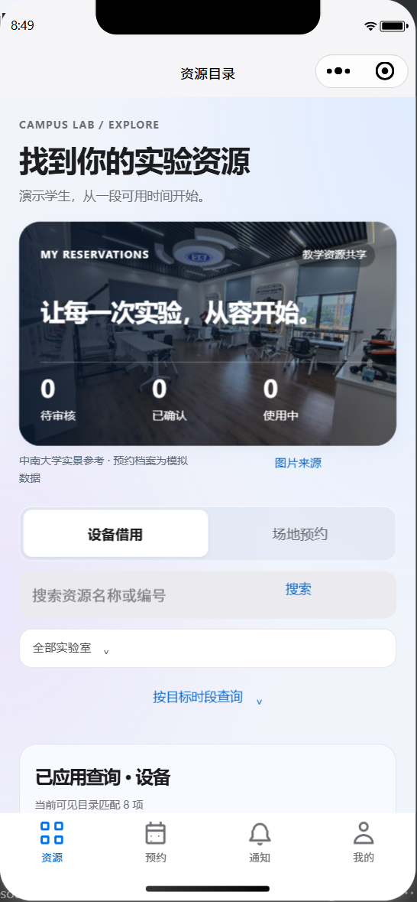

# 真实实验环境图片接入

2026年11月6日，在24fbf26基线上为网页及原生微信小程序加入三张可核对出处的中南大学实验室真实照片。沿用浅色、圆角和局部玻璃界面，照片与模拟资源档案清楚区分。

|登录页|资源目录|
|---|---|
|||

|实验环境画廊|断图降级|
|---|---|
|||

以上为隔离本地Django/PostgreSQL真实网页、模拟数据；390像素截图是浏览器视口，不是手机真机。

|原生小程序首页|原生资源详情|
|---|---|
|||

以上微信图片来自官方开发者工具SDK3.17.6、390逻辑像素，与本地真实Django/PostgreSQL联调，非真机。源站与预览包、云端更新分别取证，不能用GitHub提交替代手机更新。

[图片来源与权利说明](图片来源与使用说明.md) · [验证记录](验证记录.md) · [独立复核](独立复核.md) · [AUD-0132完整记录](问题记录.md)。Word分析报告、业务规则、数据库实体和ERD没有因本次图片展示改变。

## 云端包后续复核

最终照片版连接云端后也完成上述原生读取和断图检查，保留首次超时和本地结果，见[云端原生记录](证据/native-cloud-result.json)。

|最终云端原生首页|最终云端原生详情|
|---|---|
|||
