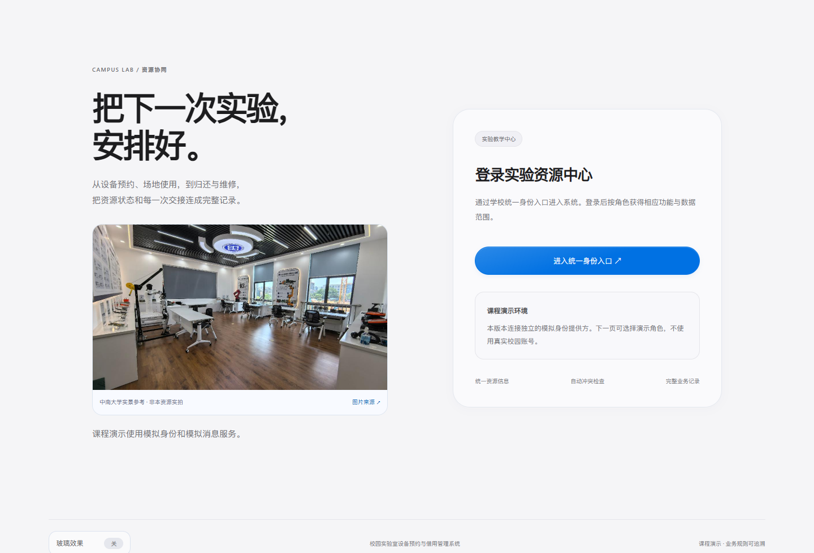

# 真实照片版发布记录

功能基线24fbf26；三张原始照片、图片目录与两端显示、来源及故障降级已经本地浏览器和微信官方容器核验。公开图片内容与私有原始下载摘要一致；非本项目MIT许可资产，边界见来源说明。

微信官方工具已生成本轮云端预览包，源文件逐项核对见证据/mini-source-receipt.json；个人AppID、私有绑定和临时预览码不在公开仓库。预览成功不等于上传体验版、正式审核发布或名称审核通过，本轮Android尚待打开确认，iPhone继续延期。

网站部署与远端CI将在真实取得结果后追加。截图与发布证据不覆盖真实校园调研、全业务端到端或正式外部身份/消息能力。

## 远端复核结果

功能提交：[c7af090](https://github.com/yvming67-gif/campus-lab-equipment-manager/commit/c7af090fd8f41078294a4c2e1ed87ea6e8d57b66)。[自动检查42140293264](https://github.com/yvming67-gif/campus-lab-equipment-manager/actions/runs/42140293264)的业务、Windows首次安装和云配置三项全部成功。校验命令新增照片原件、目录JS/JSON、两端一致性检查，不新增付费服务。

实际Render登录页200，包含新的实景组件与中南大学来源标注；photos.css和product.js的SHA-256与本地一致。三张按实际静态哈希地址请求的照片全部200，原始字节SHA-256均与来源下载原件一致。首次仍看到旧页面的观察保留于cloud-before-deploy.json，后续成功另记cloud-verification.json。

随后实际浏览器打开在线登录页，等待照片解码后截图，1440像素；没有登录或业务写入。该图是已部署页面，和前述隔离本地图分别标识。

最终官方小程序预览包384461字节（工具显示375.5KB），58个私有预览源文件与公开目录逐一核对（不含个人绑定配置）；来源摘要见mini-source-receipt.json。最后仅补充图片读屏标签并再次编译成功，不宣称实际读屏器验证。正式上传、体验版、发布、名称审核与真机验收均未由本轮预览生成替代。

后续纯说明/证据提交使用[skip render]，避免重复消耗免费网页部署；运行功能为c7af090。GitHub首页演示图同步使用本轮真实云端登录图，照片版小程序临时二维码留在本机，手机需重新扫码。
